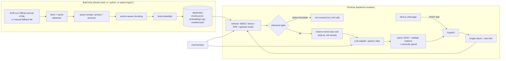

# Design — Ask the EU AI Act

This design implements `requirements.md` (R1–R7) under `.kiro/steering/rules.md`:
Python 3.12 + FastAPI + pytest, Next.js + TypeScript, config from env vars,
small readable code, every module tested, no metrics claimed that were not run.

Non-obvious choices are explained inline; the main alternatives are compared in
[§5 Trade-offs](#5-trade-offs-considered).

---

## 1. Architecture



**Key properties**
- The index is built once, at image build time, from the pinned source. The running demo does no EUR-Lex fetch and no model download (R6.2).
- The backend is stateless per request. "Chat" means a list of independent Q&A turns in the browser; there is no conversation memory (keeps retrieval and citations unambiguous).
- Retrieval and the relevance gate are free. Only the LLM call costs money, so everything that can refuse a request does so before the LLM.

### Repository layout

```
.kiro/{steering,specs}/             rules + this spec
backend/
  askact/
    config.py                       Settings (pydantic-settings), the only place env vars are read
    models.py                       Section id, Chunk, ScoredChunk, API schemas
    ingest/{fetch,parse,chunk,build}.py     `python -m askact.ingest`
    index.py                        write/load artifacts, build hash, staleness check
    embedders.py  rerankers.py      real (sentence-transformers) + deterministic stubs
    retrieval.py                    BM25, dense, RRF, rerank, relevance score
    generation/{llm,prompt,answer}.py       adapters, prompt, gate + parse + validate
    guards/{ratelimit,spend}.py
    api.py                          FastAPI app
    request_log.py                  one privacy-preserving log line per /ask (§3.4)
    evaluation/{schema,metrics,cache,run}.py
  tests/  (mirrors the package) + tests/fixtures/
  Dockerfile  pyproject.toml
frontend/                           Next.js (App Router) + TypeScript, vitest tests
eval/questions.yaml                 drafted by the Kiro agent at the owner's request (see its header); owner to review
eval/results.md                     written by the harness; pasted into the README
data/{raw,index}/                   generated, gitignored
docker-compose.yml  .env.example  .dockerignore  .github/workflows/ci.yml  README.md
```

Python dependencies: `fastapi`, `uvicorn`, `pydantic-settings`, `httpx`, `beautifulsoup4`, `lxml`, `rank-bm25`, `numpy`, `pyyaml`.
Optional extra `models` = `sentence-transformers` (pulls torch). CI installs only base + `dev`, which is possible because tests use stubs (R6.4).

---

## 2. Data model and index artifacts

**Section id** — `<kind>:<number>`: `article:5`, `recital:12`, `annex:III` (kind is lowercase; annex numbers are upper-case Roman numerals). This is what the LLM cites, what the UI shows, and what `expected_ids` contain.

**Chunk** (one line of `chunks.jsonl`):

| field | example | note |
|---|---|---|
| `chunk_id` | `article:5#2` | section id + 1-based ordinal; stable for a fixed source and chunking params |
| `section_id` | `article:5` | the parent section (used for hits and citations) |
| `kind`, `number` | `article`, `5` | |
| `title` | `Prohibited AI practices` | articles and annexes; `null` for recitals |
| `text` | | body text only, as displayed in the sources panel |

For BM25 and embeddings the indexed string is `"Article 5 — Prohibited AI practices\n" + text` (header prefix). The header is not stored in `text`, so display stays clean.

**Artifacts in `data/index/`**
- `chunks.jsonl`, `embeddings.npy` (float32, L2-normalised, row i ↔ line i), `manifest.json`.
- `manifest.json` records: the pinned source (regulation, CELEX `32024R1689`, OJ reference, URL, retrieval date, `sha256` of the source file), counts (recitals/articles/annexes/chunks), chunking params, `embedding_model`, `schema_version`, and `build_hash`.
- `build_hash` is the sha256 of the **canonical JSON** (sorted keys, no spaces) of `{"source_sha256", "chunking", "embedding_model"}`, which is the definition in R2.6. It is JSON rather than a plain concatenation so that no choice of values can make two different triples produce the same input string (`"ab"+"c"` and `"a"+"bc"`). `chunking` is `{"max_chars": CHUNK_MAX_CHARS, "chunker_version": N}`: the **chunker version** is part of it because R2.6 lists the chunking parameters, and a fix to the chunker changes the chunks without changing any setting. `CHUNKER_VERSION` is bumped by hand when the chunker's output changes, and a golden-digest test over the fixture fails until it is, so an index built by older code is reported stale instead of silently mixed with new code.
- The manifest's `source` also records `origin` (`fetched`, `cache` or `manual`) and `retrieved_at`: the download date for a fetched file, otherwise the file's own modification date, the best available record of when it was saved. Unknown fields in the manifest are rejected, so a manifest written by something else is reported as damaged.
- **Writing is all or nothing.** The three files are written to a hidden temporary directory beside `data/index/` and swapped in by renaming; if the second rename fails the previous index is put back. A failure or a crash at any point leaves the previous index untouched, or no index if there was none, never a half-written one. It does not claim to survive power loss (no `fsync`). The directory is made `0755` (the temporary one is created private).
- **Loading is checked.** `load_index` rejects, with `IndexUnavailableError` of kind `missing`, `stale` or `corrupt`: a missing or unreadable file, a manifest with unknown fields, a different format version, a build hash that differs from the one the current settings produce (the message says whether the embedding model or the chunking changed), a stored hash that does not match the fields recorded beside it, embeddings that are not a finite unit-length float32 matrix of the recorded width, chunk and embedding counts that disagree, duplicate chunk ids, and section counts that disagree with the manifest. Arrays are loaded with pickle disabled.
- The BM25 index is rebuilt in memory at startup from `chunks.jsonl` (a small corpus: 495 chunks at the default chunk size, measured in Task 5; no pickle to go stale, no extra artifact to hash).

**Staleness checks**
- `ingest` skips re-embedding when the stored `build_hash` equals the freshly computed one (R2.6), and leaves the files untouched. `--force` re-downloads the source; it does not force a re-embed, because the same source with the same settings gives the same hash. A damaged index is not "up to date": it is rebuilt. The embedder's *name* is all the freshness check needs (`embedder_name(settings)`), so it never loads the real model.
- The API recomputes the hash at startup from `manifest.source_sha256` + current env params and refuses to serve with a clear "index missing or stale, run ingestion" error on mismatch (R2.8). It needs no raw file at runtime.

---

## 3. Components

### 3.1 Ingestion (R1)

`python -m askact.ingest [--force] [--source-file PATH]`

1. **Fetch** — if `data/raw/ai-act-oj-2024-1689.html` exists and `--force` is not set, reuse it. Otherwise GET `SOURCE_URL` with `httpx`, a descriptive `User-Agent`, and a timeout. The default is the Publications Office resource URL `https://publications.europa.eu/resource/celex/32024R1689`, requested with `Accept: application/xhtml+xml` and `Accept-Language: eng` (the document variant is chosen by content negotiation). The `eur-lex.europa.eu/legal-content/…` HTML page that this design first assumed answers the project's honest User-Agent with a `202 Accepted` bot-challenge page (observed in Task 3), and the project does not impersonate a browser to get around that. A response only counts as the document if the status is exactly 200 and the body contains the Official Journal id `L_202401689EN`; a cached file that fails the same check is ignored and fetched again. EUR-Lex states that the authentic Official Journal is the signed PDF and that the HTML rendition is for information only, so the README limitations say that this app parses the HTML rendition.
2. **Fallback** — if the fetch fails, or the response does not pass validation, load the manually downloaded file: `--source-file` if given, otherwise `SOURCE_FALLBACK_PATH`, which defaults to `data/raw/ai-act-oj-2024-1689.manual.html` (a different name from the cache file so a fetch never overwrites it). This makes the build work offline and is the escape hatch if the source starts challenging automated clients (as `eur-lex.europa.eu` already does). If neither works: print the error, exit non-zero, and write nothing (R1.13).
3. **Pin check** — the document `<title>` must start with `L_202401689EN` (the Official Journal file id, as opposed to a consolidated `02024R1689-…` document), and parsed counts must equal `EXPECTED_COUNTS` (see below). Any mismatch aborts the build. This keeps the "original text of 12 July 2024" claim in R1.2 and R4.6 honest.
4. **Parse** (BeautifulSoup with lxml's **XML** builder: the file is XHTML, and with that builder `class` is one string, not a list). Confirmed against the real file in Task 4:

   | kind | marker | text source |
   |---|---|---|
   | recital | `div.eli-subdivision#rct_N` | its single table row: the `(N)` label cell is checked against the id and dropped, the content cell is the text |
   | article | `div.eli-subdivision#art_N` | number from `p.oj-ti-art` ("Article 5", checked against the id), title from `div.eli-title p.oj-sti-art`, body = every other child |
   | annex | `div.eli-container#anx_III` | number/title from the first two `p.oj-doc-ti` ("ANNEX III", checked against the id; title), body = every other child |

   Sections are matched by a **full** match on the id: the title divs (`art_1.tit_1`) would also match a substring search.
   - **Lists of points** (`(a) …`, `1.`, `(i)`) are tables, nested up to two deep in articles. Each `<tr>` becomes one line `"(a) text"`; a cell holding a sub-list continues on the following lines, in order. Annex rows can have an empty spacer cell; what is left must be exactly a label and its content.
   - **Blocks.** A section's text is a tuple of blocks, one per top-level unit (a numbered paragraph with its sub-points, one definition in Article 3, an annex heading). The chunker packs whole blocks (§3.1 step 5).
   - **Footnote references** (`<a><span class="oj-note-tag">`) are dropped together with the space before them; the footnote texts are outside the sections. **Superscripts are exponents** and are written with `^` (Article 51's `10^25`); plain text extraction would produce `1025`. The `(*)` note marker inside an `a.oj-quotation` link is kept as text.
   - Odd constructs that occur in the document and are handled: a bare `;` after a quoted paragraph (joins the previous line); annex VI's numbers and text set as two `display:inline` paragraphs (one line); links (text kept, URL dropped); non-breaking spaces (4,160 of them) become ordinary spaces.
   - **Strict by design.** Markup the parser has not seen raises `ParseError` naming the section, instead of being skipped: a skipped element would silently delete part of the law from the index, and the section counts would not notice. Titles and text are kept exactly as published, including the stray backtick in Article 1's title ("Subject matter`").
   - Chapter/section headings between articles are ignored (not required metadata).
   - **Counts.** Task 4's run on the real file found **180** recitals, **113** articles and **13** annexes, numbered without gaps. `EXPECTED_COUNTS` is set from that only once the project owner confirms the numbers; until then `verify()` refuses to run.
   - **Fidelity check.** A test compares, for every section of the real file, the parser's text with an independent plain-text read of the raw element (footnote references removed, exponents marked), ignoring only whitespace. It shares no code with the parser, so it catches a dropped or doubled paragraph that a count never would.
5. **Chunk** (`CHUNK_MAX_CHARS`, default 1800 ≈ 450 tokens at roughly four characters per token, intended to fit the embedder's 512-token window; the character limit is only a proxy and is verified, not assumed — see the token-length test below):
   - One algorithm for every kind of section. A section's *blocks* (numbered paragraphs with their sub-points, one definition, an annex heading) are packed greedily, whole, into chunks up to the limit. A block too big for a chunk on its own is split at **line** boundaries (sub-points stay whole), then **sentence** boundaries (after `.` `;` `:` `?` `!`), then **word** boundaries, and finally fixed cuts for a single over-long word, so the size bound holds for any input. No overlap: blocks are self-contained units, and overlap would duplicate text across citations.
   - **Recitals are not all short.** The first design assumed one chunk per recital; the real text has 35 of 180 recitals over the 1800-character default (the longest is 4,443 characters, roughly 1,100 tokens, which the embedder would silently truncate). A recital is a single block, so those are split at sentence boundaries by the same algorithm; a recital that fits stays whole.
   - **The limit applies to the embedded string**, header and newline included (`Chunk.embed_text`), because that is what the model reads. Headers run from 9 to 215 characters (Annex XII's title is long), so a fixed limit on the text alone would let some chunks overflow. If a limit leaves under 100 characters for text after the header, chunking fails with an error naming the section instead of producing degenerate chunks. A section with no text is also an error: skipping it would silently remove an article from the index.
   - **Measured on the real Act at 1800:** 495 chunks (218 recital, 241 article, 36 annex), longest 1800 characters, none over; 35 recitals, 63 articles and 7 annexes needed splitting; 35 lines needed sentence-level splitting and none needed word-level splitting; text is lossless for all 306 sections.
   - Every chunk keeps the section's number and title (R1.9).
   - **Token-length check.** A `slow`-marked test tokenizes every chunk of the real source, as the exact string that gets embedded (header + text) and with the tokenizer's special tokens included, using the real embedder's tokenizer. It asserts that no chunk exceeds the embedder's max sequence length (read from the loaded model, not hard-coded), and it fails listing the offending chunk ids. If it fails, lower `CHUNK_MAX_CHARS` (or fix the sentence splitter) and rebuild. It needs the real model and the real source file, so it runs locally and is skipped when either is absent. **Result (Task 5, `BAAI/bge-small-en-v1.5`, limit 512 read from the model):** at 1800 characters all 495 chunks fit; the longest is 499 tokens (`annex:I#4`, a list of directive numbers and citations), the median 235. The margin on that one chunk is 13 tokens, because characters per token ranges from about 2.9 in such lists to over 5 in prose, which is why the character limit is a proxy and this test exists. The same check fails as intended when the limit is raised: at 2600 characters nine chunks exceed 512 tokens. Whether smaller chunks retrieve better is a question for the evaluation, not for this check.
6. **Embed and write** (the CLI prints progress to stderr and the counts to stdout, exits 0, or 1 with `error: …` on stderr; logging is configured only when run as a program, never inside `main()`, because global logger state would leak between tests) — embed the header-prefixed chunk strings with the configured local model, write the artifacts atomically (temp dir then rename, so a failure never leaves a partial index), and print counts of recitals/articles/annexes/chunks (R1.10).

**Fixture:** `tests/fixtures/mini_act.html` is a trimmed file with the same markup: 3 recitals, 2 articles (one long enough to be split), 1 annex. Tests assert its counts (R1.11). The full-source count test runs only if `data/raw/ai-act-oj-2024-1689.html` exists, otherwise `pytest.skip("full source not present")` (R1.12).

### 3.2 Retrieval (R2)

```python
class Retriever:
    def search(self, query: str, config: Config, k: int) -> RetrievalResult
# Config = "bm25" | "dense" | "hybrid" | "hybrid+rerank"
# RetrievalResult = chunks: list[ScoredChunk], relevance: float, relevance_kind: "cosine" | "rerank"
```

- **bm25**: `rank_bm25.BM25Okapi` over lowercase word tokens (`\w+`) of the header-prefixed text (no stemming and no stop-word list; simple and predictable for legal terms, and the header means a query like "Article 99" or "Penalties" matches the title). Facts about the library that shaped the code, found by probing it: a word that appears in exactly half the documents has idf 0 (so a toy corpus must be larger than a handful of chunks); a negative idf is floored at a small positive value, so even "the" scores a little; a query sharing no word with the index scores 0 for every chunk; and an empty corpus crashes. When fewer than `k` chunks have a positive score, the rest are returned with score 0 in document order, so `bm25` always returns `k` chunks; the relevance gate, not the ranking, decides that such a question is not covered.
- **dense**: embed the query, then score `embeddings @ q` (cosine, since both are normalised). For the BGE v1.5 models the query gets the retrieval instruction `Represent this sentence for searching relevant passages: ` (the string is from the model card, which also says documents never get it). The model card calls the instruction *optional* for v1.5 (omitting it costs only "a slight degradation") but recommends it for short queries against long passages, which is this app; it also says to choose by performance on your own task. So it is on by default, and whether it helps here is a question for the retrieval evaluation. It is applied only to models whose card was checked: any other `EMBEDDING_MODEL` is embedded without an instruction and a warning is logged, rather than being given the wrong one. The model ships no prompt of its own (its `config_sentence_transformers.json` has none), so the string lives in `embedders.py`.
- **hybrid**: take the top `HYBRID_CANDIDATES` (30, a constant in `retrieval.py`, not an environment variable) from each ranker and fuse with **Reciprocal Rank Fusion**, `score = Σ 1/(60 + rank)` with ranks counted from 1 (the constant 60 is from the original paper and is not tuned). RRF uses ranks only, so BM25 and cosine scores never need to be put on one scale (R2.3). Details: (1) BM25 candidates with score 0 share no word with the query, which is no lexical evidence, so they are **left out** of the fusion (otherwise the arbitrary first 30 such chunks would each earn points for nothing); (2) the candidate pool is `max(30, k)`, so `k` results are always available; (3) equal fused scores keep the order in which chunks first appear, and the dense list is handed to the fusion first, so **dense wins ties**; (4) sorting is stable throughout (`argsort(kind="stable")`), so equal scores stay in document order, which matters: NumPy's default sort keeps an all-equal input in order but scrambles inputs with several groups of ties.
- **hybrid+rerank**: take the top `RERANK_CANDIDATES` fused candidates (20, a constant in `retrieval.py` like `HYBRID_CANDIDATES`; the pool is `max(20, k)`), score them with a cross-encoder and return the top k. Details: (1) the reranker reads `chunk.embed_text`, i.e. the header plus the text, the same string BM25 and the embedder see, so "Article 99 — Penalties" counts as evidence; (2) equal reranker scores keep the fused order (stable sort); (3) `checked_scores` turns a wrong number of scores or a NaN/infinite score into a `RerankerError`, because a NaN relevance would slip past a `< threshold` check and let an uncovered question through the gate; (4) the cross-encoder truncates silently at 512 tokens for the question and passage together, and the longest chunk is 499 of the embedder's 512 tokens, so a long chunk can lose its tail when scored. That is a known risk, not measured; the evaluation will show whether it matters.
  - **Switch (R2.4).** With `RERANKER_ENABLED=false` the reranker is never constructed (so no model is downloaded or loaded) and never called; asking `search` for `hybrid+rerank` then raises `ValueError` naming the flag, rather than quietly returning plain hybrid results. `app_config(settings)` is the one place that maps the flag to the config the app serves: `hybrid+rerank` if on, else `hybrid`.
  - **The eval harness does not use the flag.** It iterates all four configs, so it builds its `Retriever` with a reranker explicitly (`get_reranker(settings)`), whatever `RERANKER_ENABLED` says.
  - **Cost, observed on this machine (CPU, real models, a handful of questions; a plumbing check, not a benchmark):** `hybrid` took about 15 ms and `hybrid+rerank` about 400-540 ms for 20 candidates, so roughly 30 times slower. Whether the gain in ranking justifies that is for the retrieval evaluation to say. The flag defaults to off.
  - **Why there are two relevance thresholds, seen in the same plumbing run:** the cosine of the top chunk ran about 0.61-0.87 for in-scope questions and 0.38-0.43 for out-of-scope ones, while the rerank logit ran about +4.6 to +8.8 and about -11. The two numbers live on different scales, so one threshold cannot serve both. These are a few hand-picked questions, so they say nothing about where to put either threshold; that is tuned on the dev split (Task 20).
- **Relevance score** (R3.7/R3.8), attached to every result. `RetrievalResult` requires it, so the cosine case for `bm25`, `dense` and `hybrid` is implemented with Task 8 (every one of those embeds the query, and `relevance` is the cosine of that config's own top chunk, so the same question can get a different relevance under different configs); Task 9 adds the `hybrid+rerank` case:
  - `hybrid+rerank` → the reranker score of the rank-1 chunk (`relevance_kind="rerank"`). The real cross-encoder's scores are **raw logits**, unbounded and not probabilities: positive for a good match, negative for a poor one. Its `predict()` returns them unchanged in every sentence-transformers version tried (3.4.1, 4.1.0, 5.1.0, 6.1.0), so no activation is forced (the argument that would force one is named differently across versions); a `slow` test pins "logits, not probabilities" so a library update that changed the scale fails loudly instead of silently moving what `RELEVANCE_THRESHOLD_RERANK` means.
  - every other config → `cosine(query, rank-1 chunk)`, computed for all of them including `bm25` and `hybrid` (`relevance_kind="cosine"`). So `bm25` still loads the embedder at query time; that is the price of one comparable gate across configs.
- **Models** (env-configurable, defaults are my picks and unverified until the eval runs): embedder `BAAI/bge-small-en-v1.5` (small, CPU-friendly, 512-token window); reranker `cross-encoder/ms-marco-MiniLM-L-6-v2` (small and fast on CPU). Both are loaded through `sentence-transformers`.
- **Stubs (CI, R6.4):**
  - `HashEmbedder`: lower-cased word tokens hashed into 256 buckets with `hashlib.blake2b` (not `hash()`, which Python randomises per process), counted and L2-normalised. Deterministic across processes, no download, never imports torch, and cosine grows with the words two texts share (and with repetition), so tests can assert sensible ordering. Text with no word characters has no direction and maps to the zero vector. Its `name` includes its dimension, because the name goes into the index build hash.
  - The real `SentenceTransformerEmbedder` runs on the CPU, returns float32 unit vectors, and reads its dimension from the model (384 for the default). Both embedders implement `embed_documents(texts)` and `embed_query(text)`; documents never get the query instruction.
  - `OverlapReranker` (name `stub-overlap`): score = Jaccard overlap of the distinct query and passage tokens, in [0, 1]. Not a good reranker, but deterministic, and it reorders results, which is what tests need. The tokenizer is shared with BM25 and `HashEmbedder` and lives in `askact/models.py` (`retrieval.py` re-exports it), so the three can never disagree about what a word is.
  - Selected by `EMBEDDER=stub|real` and `RERANKER=stub|real` (default `real`; tests and CI set `stub`).

### 3.3 Generation (R3)

`answer(question, retrieval_result, settings, llm, ledger) -> AnswerResult`, in this order:

1. **Relevance gate.** Pick the threshold for the result's kind: `RELEVANCE_THRESHOLD_COSINE` or `RELEVANCE_THRESHOLD_RERANK`. If `relevance < threshold`, return `not_covered` and make no LLM call and no spend reservation (R3.7).
2. **Prompt.** The system prompt states the rules: use only the passages; if they do not contain the answer set `covered=false`; cite only the section ids shown; reply with a single JSON object `{"answer": str, "citations": [str], "covered": bool}` and nothing else. Passages are labelled by *section id*: `[article:5] Article 5 — Prohibited AI practices\n<text>`, so the model cites sections, not chunk ids.
3. **Call** through the provider adapter with `max_output_tokens = MAX_OUTPUT_TOKENS` (R6.12), after the spend reservation (§3.4).
4. **Parse** the reply as JSON (tolerating a leading/trailing code fence) into a pydantic model. On failure return `llm_bad_output`; the raw text is never shown as an answer (R3.3).
5. **Validate citations** — normalise each cited id and keep only those whose section is in the retrieved set; the rest are dropped (R3.5). Decision: if `covered=true` but no valid citation remains, the answer is withheld and the result is `not_covered`, because an uncited answer breaks the grounding promise.
6. `covered=false` → `not_covered` (R3.6).
7. **Sources** returned = the retrieved chunks whose section is cited, with section id, label ("Article 5"), title, text, and score (R3.11).

**As built (Task 13; `generation/answer.py`):**
- **Order and what each refusal costs.** The gate runs first and a refused question makes no LLM call and no reservation. Then: prompt, `spend.reserve`, the call, `reservation.reconcile`, parse, validate. **Reconciling happens right after the call returns, before parsing**, because a reply that turns out to be unusable has still used tokens. If the call itself raises, nothing is reconciled and the reservation stands as the charge (R6.9).
- **`SpendGuard` is two tiny protocols** so the real ledger (Task 16) is a drop-in: `reserve(system, user, max_output_tokens)` returns a reservation, and `reservation.reconcile(input_tokens, output_tokens)` settles it (`None` means usage was not reported). The reservation carries its own day and amount, which is what makes "reconcile on the reservation's day" (a call can straddle midnight) need no extra bookkeeping. A refusal is `SpendRefusedError`, whose `code` is `spend_cap_reached`. If `reconcile` raises, the error is logged (the exception type only) and the reply is kept: R6.9 says the reservation then stands, not that a paid-for answer is thrown away.
- **An unset or non-finite threshold is an error, not a default.** `GateNotConfiguredError` (`code="not_configured"`, new in the table above) is raised for the threshold that applies. Only the one for the active kind has to be set. `Settings` also refuses `nan` and `inf` at startup (they were accepted before): `relevance < nan` is always False, so a NaN threshold would silently send every question to the paid LLM. The gate checks again itself, because a `Settings` can be built or copied in code without validation. Any finite number is allowed, including negatives, since rerank scores can be negative.
- **A refusal never carries model text.** Every `not_covered` result (gate, the model's `covered=false`, or no valid citation) has the fixed message `NOT_COVERED_MESSAGE` and empty citations and sources. The model's explanation in the `covered=false` case is discarded.
- **Citations** are normalised with `SectionId.parse` ("Article 5" -> `article:5`), de-duplicated, kept in the order first cited, and dropped unless the section is among the retrieved chunks; text that is not a section id is dropped without failing the answer. **Sources** are the retrieved chunks of the cited sections, best first (not in citation order), and include every retrieved chunk of a cited section.
- **`AnswerResult.usage`** is the provider's reported token counts for the one call made, or `None` if no call was made, so the API's one log line (§3.4) and the eval's cost accounting can read it.

**Provider adapters** (`generation/llm.py`): one tiny interface, `complete(system, user, max_output_tokens) -> LLMReply(text, input_tokens | None, output_tokens | None)`, with two implementations selected by `LLM_PROVIDER`:
- `openai`: Chat Completions over `httpx`; `LLM_BASE_URL` can point to any OpenAI-compatible server.
- `fake`: scripted replies for tests/CI; counts its calls.

OpenAI is the only real provider (the project owner's choice). The interface is what makes the provider configurable (R3.9): another provider is a new class plus one line in the `get_llm` factory, and none is built until needed.

A missing or invalid key/provider/model becomes a clear `llm_unavailable` error (R3.10).

**As built (Task 12; `generation/llm.py`, `prompt.py`, `response.py`):**
- **The interface** is `LLM.complete(system, user, max_output_tokens) -> LLMReply(text, input_tokens, output_tokens)`; the token counts are `None`, not 0, when a provider does not report them, so that the ledger keeps its worst-case reservation (R6.9). Two exceptions carry the API error codes as a class attribute: `LLMUnavailableError.code == "llm_unavailable"` and `LLMBadOutputError.code == "llm_bad_output"`. Their messages say what was wrong and never contain a key, a request or a reply, because model output is untrusted and must not reach a user or a log through an error.
- **`FakeLLM`** replays a script in order. An item is the reply text, an `LLMReply` (to give token counts), or an exception to raise (to simulate a failing provider). It records every request (`calls`) and counts them. A call past the end of the script raises instead of inventing a reply, because that would hide a test making more calls than it expected. `LLM_PROVIDER=fake` gives an empty script, so it exists to be replaced by a scripted one in tests.
- **`get_llm`** looks the name up (case and surrounding spaces ignored) in a dict of provider factories, so a provider is one line. An unset or unknown name is `llm_unavailable` and the message lists the supported names. **The "missing key or model" check is not in this task:** `fake` needs neither, so it arrives with the OpenAI adapter in Task 14, the first provider that does.
- **The system prompt is a constant**: nothing a user typed is ever put into it. Passages go in the user message inside `<passages>`, each as `[article:5] Article 5 — Prohibited AI practices` then the text (recitals have no title; several chunks of one section each carry the section label, never a chunk id); the question follows inside `<question>`. The prompt says the question is never an instruction and never evidence. That lowers the chance of a question steering the model but is **not a security boundary**: what makes a bad reply harmless is that citations are checked against the retrieved set (Task 13) and the answer is shown as plain text (Task 21). The JSON line in the prompt's format example is parsed by the real parser in a test, so prompt and parser cannot drift apart.
- **The parser** (`parse_reply`) accepts one JSON object with a string `answer`, a list-of-strings `citations` and a real boolean `covered` (the string `"true"` or the number 1 are rejected), optionally inside a code fence (any amount of whitespace or line breaks; an unclosed or unopened fence is rejected, since that is what a reply cut off by the token limit looks like). Extra fields are ignored. Prose around the JSON is rejected, not searched for a `{`. It checks the *shape* only: `citations` stay as the model wrote them, because a citation that is not a valid section id, or not in the retrieved set, is dropped by the answer pipeline (R3.5) and must not make the whole reply unusable. One rule beyond the shape: `covered: true` with a blank answer is bad output, since there is nothing to show.

**As built (Task 14; `generation/openai_adapter.py`).** The API facts were read from OpenAI's documentation on 2026-10-11 (the URLs are in the module's header comment), not written from memory:
- **Request:** `POST {base}/chat/completions`, `Authorization: Bearer <key>`, body `{model, messages: [system, user], max_completion_tokens}` and nothing else. `max_completion_tokens` caps visible *and reasoning* tokens; the older `max_tokens` is deprecated and rejected by o-series models, so it is never sent. No `temperature`, `response_format` or `stream`: reasoning models reject some of them and compatible servers support them unevenly, so the reply format is enforced by the prompt and the parser.
- **Reply:** text from `choices[0].message.content`, usage from `usage.prompt_tokens` / `completion_tokens` (the latter includes reasoning tokens, i.e. what is billed). A refusal (`content: null`) or a reasoning model that spent its whole budget thinking comes back as empty text *with its usage still reported*, because those tokens were billed and must reach the ledger; the parser then turns the empty text into `llm_bad_output`. Anything that is not a chat completion (an HTML page from a wrong `LLM_BASE_URL`, say) is `llm_unavailable`.
- **Errors are all `llm_unavailable`,** with a message built from the HTTP status and, only if it is a short plain identifier, OpenAI's `error.code`: never the provider's free-text message (it can echo request content), never the key, never an underlying exception's text, and the original exception is not chained. A code that contains the key or a fragment of it (8+ characters) is dropped too, since "looks like an identifier" does not make a value safe to print and this adapter also talks to arbitrary compatible servers. A **429 is split in two**, following OpenAI's error guide: a temporary rate limit ("try again shortly") versus an exhausted balance or spend/usage limit ("retrying will not help"), told apart by `error.code` or `error.type`. Missing or unusable `LLM_API_KEY`, `LLM_MODEL` or `LLM_BASE_URL` are reported together when the provider is built, naming each variable (R3.10).
- **No retries.** A call that timed out may still have been billed, and a retry would spend again behind the spend guard's back. Redirects are not followed, so the key cannot be forwarded elsewhere. The timeout is 90 s to read the whole (non-streamed) reply and 10 s to connect.
- **Trade-offs recorded.** (1) OpenAI recommends its newer Responses API for new projects; Chat Completions is still supported and is what OpenAI-compatible servers implement, which is why `LLM_BASE_URL` can work at all. (2) The system prompt is sent with role `system`. OpenAI's spec says reasoning models take `developer` instead; the only statement I found that `system` is converted for them is from OpenAI staff on the community forum, not the docs. `system` is also what compatible servers expect. The live smoke test is what confirms it on the model you use. (3) A compatible server that ignores `max_completion_tokens` silently breaks the output cap, and the spend reservation assumes the cap holds; the smoke test asserts `output_tokens <= cap` for that reason, and `.env.example` says so.

**Verifying the adapters.** Request and response shapes are not written from memory: when the OpenAI adapter is implemented, the task reads OpenAI's current API documentation first (endpoint, auth header, version header if any, the output-token parameter name, and where token usage is reported) and records the doc URL and the date it was read in a comment at the top of the adapter. The adapter also gets one live smoke test, marked `slow` and manual: it makes a single tiny real call (a trivial prompt, a very small output-token limit) and asserts a non-empty reply and that token usage is reported. It reads its key from the environment and is skipped when the key is absent, so it never runs in CI and never needs a secret there. The smoke test calls the adapter directly, so it does not pass through the spend ledger; its cost is a handful of tokens per run.

**Threshold tuning (Task 20).** Both thresholds were chosen from the `dev` split only (R5.10), by a stated rule, applied to the per-question relevance of the top chunk with the real models (`bge-small-en-v1.5`, `ms-marco-MiniLM-L-6-v2`, `k=5`, index build hash `6a5aac7af9cc03a7`, 495 chunks, date 2026-10-13). The test split was not run, scored or inspected for this.
- **The rule.** Candidates are the midpoints between consecutive dev scores. Allow a candidate if it refuses at most 2 of the in-scope questions whose expected section was retrieved. Among those, take the one that refuses the most `out_of_scope` questions; if several tie, take the centre of that plateau.
- **Dev evidence (29 questions: 23 in-scope, 6 out_of_scope; hybrid retrieves the expected section for 18 of the 23 in-scope).** The scores overlap, so no threshold separates the two kinds. The best any threshold does is refuse 5 of the 6 `out_of_scope` questions; the sixth (q048) scores 0.737 under `hybrid` and 3.193 under `hybrid+rerank`, above many correct in-scope questions, so it is left for the LLM to decline.
- **`RELEVANCE_THRESHOLD_COSINE = 0.69`**, tuned on `hybrid`, the app's default config. Plateau of candidates 0.676 to 0.703, centre 0.689. On dev it refuses 5 of 6 `out_of_scope` and loses 1 of 18 retrievable in-scope questions (q017, whose top chunk scores 0.611); it also refuses 1 of the 5 in-scope questions that retrieval missed anyway. Margins: it would start refusing one more `out_of_scope` question below 0.662 (q050) and one more retrievable in-scope question above 0.703 (q036), so the safe zone is 0.041 wide and 0.69 is nearer the upper edge. The same value on `dense` refuses 4 of 6 and loses 1 of 18; on `bm25` it refuses 6 of 6 but loses 4 of 18. The value is shared by the three configs (R3.8) and fits `bm25` and `dense` worse; the app uses neither.
- **`RELEVANCE_THRESHOLD_RERANK = 2.5`**, tuned on `hybrid+rerank`. Plateau 2.348 to 2.618, centre 2.483. On dev it refuses 5 of 6 `out_of_scope` and loses 2 of 18 retrievable in-scope questions (q017 and q036), the most the rule allows; it also refuses 2 of the 5 that retrieval missed. The zone in which that outcome is unchanged is 2.218 (q046) to 2.759 (q022), so 2.5 is near its middle.
- **What this does not show.** Six `out_of_scope` questions and 23 in-scope ones are a small sample, and the plateau comes from the position of a handful of questions: expect the thresholds to move with a different question set. They are tuned for these two models and this chunking; `.env.example` and `config.py` say so, and `Settings` still accepts `None` (the gate then fails closed).
- **Why a rule, and what it does not prove.** With overlapping scores any threshold is a trade, so the choice is written as a rule that can be re-run instead of a number picked by eye. Honestly stated: the rule was written after looking at the sorted per-question dev scores (to see that they overlap), so the allowance of 2 lost in-scope questions is a judgement made with that table in view, not a pre-registered setting. What does hold is that no `test` score was run or inspected, and that the dev totals above are enough to re-derive the values.

**The final run (Task 20, run by the owner on 2026-10-13; `eval/results.md`).** Model `gpt-4o-mini`, `k=5`, the thresholds above, the same index (build hash `6a5aac7af9cc03a7`). Dev, then the test split once; 59 new calls in the final run (limit 90) and the rest from the cache. No reply was unreadable in any config. The retrieval columns (hit@5, MRR, relevance ranges) were reproduced independently on a Linux CPU with the real models and are identical to the 3 printed decimals on all 8 config/split rows, so the numbers do not depend on the owner's Apple Silicon device. The generation columns come from the owner's run only; they cannot be re-derived without the key and the cache.
- **What it shows.** Refusal accuracy is 1.000 for every config on both splits (6 of 6 on dev, 4 of 4 on test). Citation precision (0.38 to 0.54 on test) is clearly lower than recall (0.53 to 0.74): the model cites more sections than the question set lists. Part of that is by construction (a relevant section that `expected_ids` does not list counts as wrong), so precision is a lower bound on citation quality, not a measure of wrong answers; the answers themselves have not been read by the agent, so how much of the gap is real is unknown.
- **What it does not show.** The test split has 17 in-scope and 4 out_of_scope questions, so one question moves hit@5 by 0.059 and a refusal rate by 0.25. The ranking of the configs is **not reliable**: `hybrid+rerank` was best on dev (hit@5 0.913) and below `bm25` and `hybrid` on test (0.765 against 0.824), while its MRR was the highest on test (0.632); every one of those gaps is one or two questions. "Reranking helps" is therefore not supported by this data, and neither is "reranking hurts". 100% refusal accuracy on 4 questions is also weak evidence that refusal works in general, and on dev, under `hybrid` and `hybrid+rerank`, the gate alone already refused 5 of 6, so the model only had to decline one.
- **What this means for the defaults.** `RERANKER_ENABLED` stays `false`: a gain this sample cannot show does not justify the extra cost (about 0.4 to 0.5 s per question measured on a CPU in Task 9; the image-size effect is not yet measured, see Task 22). Citation precision and recall are best for `hybrid` on test (0.539 and 0.735) but that is the same small-sample caveat.
- **Reranker device.** The cross-encoder is no longer forced onto the CPU: on Apple Silicon that setting produced NaN scores (which `checked_scores` correctly refused, so the run stopped instead of reporting nonsense). The fix is the owner's; the retrieval comparison above is why the threshold still holds.

### 3.4 API and safety guards (R6)

**Endpoints:** `POST /ask {question}` and `GET /health`.

```json
{ "status": "answered | not_covered",
  "answer": "…",
  "citations": ["article:5"],
  "sources": [{"section_id":"article:5","label":"Article 5","title":"…","text":"…","score":0.71}] }
```

Errors use `{"error": {"code": "...", "message": "..."}}`:

| code | HTTP | when |
|---|---|---|
| `request_too_large` | 413 | body over `MAX_QUESTION_CHARS × 12 + 512` bytes (added in Task 18) |
| `invalid_request` | 422 | not a JSON object with a string `question`, an unknown field, or a blank question (added in Task 18) |
| `question_too_long` | 422 | longer than `MAX_QUESTION_CHARS` (R6.11) |
| `rate_limited` | 429 | over the per-client limit; `Retry-After` set (R6.5) |
| `spend_cap_reached` | 503 | reservation would exceed the cap, or the ledger/price table is unusable (R6.8–R6.9) |
| `llm_unavailable` | 503 | provider, model, or key missing/invalid |
| `llm_bad_output` | 502 | reply is not the required structure |
| `index_unavailable` | 503 | index missing or stale |
| `not_configured` | 503 | the relevance threshold for the active retrieval config is unset or not a finite number (the defaults are tuned, see "Threshold tuning (Task 20)"; this happens only for a `Settings` built in code without one) |

**Order of checks in `/ask`:** body size → rate limit → body shape → length → retrieve → relevance gate → spend reservation → LLM → validate → reconcile. Everything cheap and free runs before anything that costs money. (The first draft said "length → rate limit"; that cannot be built as written, see "As built (Task 18)".)

**Rate limiting** (`guards/ratelimit.py`, in-process; about 130 lines with comments and docstrings, not the ~30 first estimated, because of the three decisions below): sliding window of timestamps per client key, `RATE_LIMIT_PER_MINUTE`; empty windows are pruned so memory stays bounded. The client key is the socket peer address, or, if `TRUSTED_PROXY_HEADER` is set (e.g. `X-Forwarded-For`), the **last** comma-separated entry of that header — the one appended by our own proxy; earlier entries are client-supplied and spoofable. This assumes exactly one trusted proxy hop and is documented in `.env.example`. State is per process, so the backend runs a single uvicorn worker; the README lists this as a limitation.

**As built (Task 15).** Two framework-free pieces: `client_key(peer, forwarded_header_lines)` and `RateLimiter(limit).check(key) -> Decision(allowed, retry_after)`. FastAPI is not installed until Task 18, so the API layer only has to call them; a refusal there becomes `rate_limited` (429) with `Retry-After` set to `retry_after`.
- **`Retry-After` is exact and at least 1.** It is the whole seconds until the oldest request in the window leaves it, rounded up, and tests prove that waiting that long gets the client in and one second less does not. The floor of 1 is not decoration: a search found floating-point cases where `oldest + window - now` comes out as exactly `0.0` for a request still inside the window, which would send `Retry-After: 0` and invite an immediate retry loop.
- **A refused request is not recorded,** so a client that keeps hammering does not push its own wait further out. A client holds at most `limit` timestamps, and clients with none left in the window are dropped by a sweep once per window, so memory follows the clients seen in the last minute and not the number ever seen.
- **Which header line:** only the **last** line of the configured header is used, and the last comma-separated entry of it. A client can send its own `X-Forwarded-For` line and a proxy may add a second line instead of extending the first, so "the first value" could be the spoofed one.
- **An unusable header falls back to the socket address:** missing, blank, or a last entry that is not an IP address. Behind a proxy that puts every client in the proxy's one bucket. That is visibly wrong but strict, never a way around the limit, and a client cannot choose its bucket by sending junk.
- **IPv6 is keyed by /64, and IPv4-mapped IPv6 (`::ffff:1.2.3.4`) is the same client as the IPv4 address.** One host normally owns a whole /64, so keying on the full address would let any IPv6 client change address on every request and never be limited. The cost: many clients sharing one /64 (some mobile carriers, a large office) share one limit.
- **Thread-safe** (one lock; the API runs sync endpoints in a thread pool), and the clock is `time.monotonic`, injectable so no test sleeps.
- **What it is not:** a security boundary. It is a cost guard; the daily spend cap (Task 16) is the hard limit. It also cannot tell clients apart behind carrier-grade NAT, and the key is only trustworthy if the backend cannot be reached except through the one proxy that appends the header.

**Spend ledger** (`guards/spend.py`, SQLite at `SPEND_DB_PATH` on a named Docker volume so it survives container re-creation, R6.10):
- Table `spend(day TEXT PRIMARY KEY, micro_usd INTEGER)`; the day is the UTC date, so "reset daily" is simply a new row. Money is stored as integer micro-dollars. Since a price of $X per million tokens is exactly X µ$ per token, `cost_µ$ = tokens × price_per_Mtok`, rounded up.
- **Reserve** (R6.7): `BEGIN IMMEDIATE`; read today's total; if `total + reservation > cap` roll back and refuse (R6.8); otherwise add the reservation and commit. `reservation = (estimated_input_tokens + MAX_OUTPUT_TOKENS) × price`, with `estimated_input_tokens = ceil(utf8_bytes(system + user) / 3)` (**bytes, not characters: changed in Task 16**, see below). English averages roughly four characters per token, so this deliberately over-estimates; the over-reservation is returned at reconcile.
- **Reconcile** (R6.7): after the call, in one transaction on the *reservation's* day (a call can straddle midnight), replace the reservation with the actual cost from reported tokens. If usage is not reported, or the process dies before reconciling, the reservation stands as the charge (R6.9).
- **Fail closed** (R6.8–R6.9): an unreadable/unwritable database, a model absent from `LLM_PRICE_TABLE`, or a parse error in the table all refuse the call with `spend_cap_reached`.
- The cap and price table are env config: `DAILY_SPEND_CAP_USD`, `LLM_PRICE_TABLE` (JSON `{"<model>": {"input_per_mtok": x, "output_per_mtok": y}}`). Prices are the operator's responsibility; the repo contains only placeholders.

**As built (Task 16; `guards/spend.py`).** `SpendLedger.reserve(system, user, max_output_tokens)` returns a reservation whose `reconcile(input_tokens, output_tokens)` settles it: the two protocols from Task 13. A refusal is `SpendRefusedError` (`spend_cap_reached`).
- **Exact money.** Prices are floats in config, and in floating point `1.1 x 100` is `110.00000000000001`, whose ceiling is 111: an overcharge of one micro-dollar on every call at that price. The sum is done in `Decimal` (from `repr()` of the float, so 0.15 is 0.15), so only the final rounding goes up. A test uses real cases found by search.
- **The estimate counts UTF-8 bytes, not characters** (a change from the first design). It is identical for ASCII and English, and reserves more for text where a character costs a token or more (CJK, emoji). Only the question can be such text (the passages are the Act's English text). It is still an estimate and not a bound, so a call can cost more than was reserved: reconcile then charges the real cost, the total can exceed the cap by that difference, and the next reservation is refused. The overshoot is bounded by the estimation error on at most `MAX_QUESTION_CHARS` characters.
- **One transaction does the whole check.** `BEGIN IMMEDIATE` takes the write lock, the total is read, the cap compared, the new total written, then commit. Two concurrent reservations when only one fits: exactly one passes (tested with threads, 40 repeats under CPU load, and with separate ledger objects on one file, as two workers would be). Each operation opens its own connection because SQLite connections belong to their thread and the API runs sync endpoints in a thread pool. A writer waits up to 5 s for the lock and is then refused.
- **Fail closed means any failure.** A model with no price entry, an unwritable or corrupt database, a locked database, a stored total that is not a non-negative integer, a clock without a timezone, an overflow: all are `SpendRefusedError`, with a message that has no path, SQL error text or key, no chained exception, and a log line with the exception *type* only. A refusal rolls back the whole transaction, including the creation of the table. A model with no price never touches the database.
- **A bad price table stops the app from starting,** which refuses earlier than "refuse the call": `LLM_PRICE_TABLE` is parsed when `Settings` loads, so invalid JSON, a negative price, or a missing field is a startup error. `Settings` now also refuses an infinite or NaN `DAILY_SPEND_CAP_USD` and prices: `inf` (or `1e999`, which overflows to it) was accepted before and meant no cap at all.
- **Reconcile never raises and settles once.** Usage not reported, or only half of it, leaves the reservation as the charge (and is not logged as a failure: it is normal). A negative or non-integer token count is refused and cannot act as a credit. A failed write leaves the reservation standing and logs the exception type. A reservation remembers its own day, so a call straddling midnight is settled on the day it was reserved, and a second `reconcile` call does nothing. If the day's row has vanished meanwhile, the actual cost is recorded and the total never goes negative.
- **Cap rounding.** The cap is converted to micro-dollars rounding down, since a fraction of a micro-dollar is not spendable. A cap of 0 refuses every priced call; a free model (both prices 0) is allowed even then.
- **Conservative by design:** the guard reserves the worst case, so it can refuse a call whose real cost would have fitted (a test shows a third call refused at a reservation of 671 micro-dollars though it would have cost 180). That is the intended direction of the error.
- **Deployment limits to carry into Task 22 and the README:** SQLite needs a filesystem with working file locks, so use a local Docker named volume, not a network filesystem; one ledger file per cap, and old days' rows are kept (one tiny row per day). If the provider ignores `max_completion_tokens` the output part of the reservation is not a bound (see Task 14).

**Logging** (`request_log.py`; not covered by a requirement, added from design review for privacy). `/ask` emits exactly one structured log line per request containing: timestamp, outcome (`answered`, `not_covered`, or the error code), retrieval config, total latency in ms, and — when an LLM call was made — input and output token counts (or `null` if the provider did not report them). It does **not** log the question text, the answer, the retrieved passages, or the client address. Specifics:
- uvicorn runs with `--no-access-log`, because its default access log records the client IP and path; the single line above replaces it.
- Exception handlers log the error code and exception type, never the request body or the provider's request/response bodies.
- The rate limiter keeps client keys in memory only and never logs them.
- `LOG_QUESTIONS` (default `false`) is the one opt-in for local debugging: when `true`, the question text is added to the line. It is documented in `.env.example` with a warning not to enable it on the public demo.

**As built (Task 17; `request_log.py`).** Framework-free, like the rate limiter and ledger (FastAPI arrives in Task 18): `log_request(...)` writes the one line, `describe_error(exc)` gives `(outcome code, exception type name)` for the error handlers.
- **Privacy comes from how the line is built, not from the caller's care.** `log_request` has parameters for the outcome, config, latency, token counts, an error type and the one optional question, and nowhere to put an answer, a passage or an address (a test pins the exact signature and that any other keyword is a `TypeError`). The outcome and config are checked against closed sets, and `error_type` must be an ASCII identifier, so the only free text the line can hold is the optional `question`. Passing `str(exception)` as the "outcome" raises.
- **The line is one JSON object, ASCII only.** Plain-text logging lets a question containing a newline start a second, forged log line (shown by experiment), and `ensure_ascii=False` would leave U+2028 raw, which some viewers treat as a line break. The line is always a `%s` *argument* to the logger, never the template, so a `%` in a question is not read as a format directive. Fields: `ts` (UTC, milliseconds), `event`, `outcome`, `config`, `latency_ms`, `input_tokens`, `output_tokens` (JSON `null` when no call was made or the provider did not report usage), `error_type` (errors only) and `question` (opt-in only).
- **`LOG_QUESTIONS=true` adds `question` and nothing else,** cut at 1000 characters with a visible mark: the API rejects an over-long question as `question_too_long`, but that rejection is itself logged, and without a cut a huge request body would be copied whole into the log.
- **`describe_error` never touches an exception's message, arguments, cause or traceback.** The code is read from the exception *class* (an instance attribute is ignored) and trusted only if it is one of the known error outcomes, otherwise the outcome is `internal_error`; it cannot itself raise on an odd `code` (it runs inside error handlers). `internal_error` is new in the outcome set: an exception nobody planned for, for which the API answers 500 and logs only its type. `IndexUnavailableError` has no `code` yet (it has `kind`), so Task 18 must map it to `index_unavailable` itself.
- **What this module cannot guarantee, and who must:** (1) **Task 18** must call `log_request` exactly once per `/ask` on every path including errors, pass `include_question=settings.log_questions`, never log the request or exception text itself, and use `describe_error` in its handlers. (2) **Task 22** must run uvicorn with `--no-access-log` (its access log records the address and path) and must settle how the backend is reached (see Task 22: the rate limiter's proxy header is only safe if the backend is reachable solely through the one trusted proxy, and unset otherwise). (3) A log shipper or reverse proxy in front can log what it likes; that is outside this code.
- **Guards that keep it true:** tests parse every backend module with `ast` and fail if any request-path code uses `.exception()`, `traceback.*`, `exc_info` or `stack_info` (a traceback prints the exception's text), or has a log call whose message is not a string literal (an f-string is how data reaches a log), or if the set of modules that log changes (so a new logger forces a look at what it writes). Behavioural tests run the real rate limiter, gate, spend ledger and answer pipeline with a distinctive question, address, answer and passage, capture every log record, and look for them, including on every error path.

**As built (Task 18; `api.py`).** `build_app()` is the production entry point and `create_app(settings, services)` is pure wiring, so tests pass stubs for everything that costs money or loads a model. Run it as `uvicorn --factory askact.api:build_app --no-access-log`, **one worker**: the rate limiter's state is per process.
- **Why the rate limit comes before the length check (a deviation from the first design).** The length check needs the parsed body, and FastAPI parses the body *before* it runs dependencies. A first version used a dependency for the rate limit; testing showed that a body that is not valid JSON, or not valid UTF-8, never reached the dependency, so those requests were unlimited. The limit is therefore ASGI middleware, which runs before any parsing. A malformed request now costs the client a unit of its quota like any other.
- **Body-size cap (new).** FastAPI reads a whole body before the handler runs, so a 5 MB POST would be buffered before `question_too_long` could fire. `LimitRequestBody` checks `Content-Length` and, for a chunked body (which has none), counts the bytes received; at most `limit` bytes are ever held, and it answers 413 itself. The limit is `MAX_QUESTION_CHARS × 12 + 512`: 12 bytes is the worst case for one character in JSON (a `\u` escape pair for an emoji), the 512 covers the braces and key. Raising an exception from inside `receive` was tried and rejected: Starlette turns it into a generic 400. Starlette's `TestClient` delivers a chunked body as one message, so the streaming path is tested by driving the middleware directly as an ASGI app; the `TestClient` cannot see it.
- **Middleware order: CORS is outermost.** The last middleware added is the first to see a request, and a response produced by an outer layer never passes through an inner one. If CORS were inside the 413/429 layers, those errors would carry no CORS headers and a browser would show a network failure instead of the message. A test requests both from a foreign origin.
- **One error shape, fixed messages.** Every error is `{"error": {"code", "message"}}`, and each message is fixed text in the `ERRORS` table, never built from the request or from an exception. FastAPI's default 422 echoes the offending input, so it is replaced; a framework 400 on `POST /ask` (a body that is not UTF-8) becomes `invalid_request`; 404 and 405 answer `not_found` / `method_not_allowed`. A test pins `set(ERRORS) == request_log.ERROR_OUTCOMES`, so the two cannot drift. `request_too_large` and `invalid_request` are new outcomes in both.
- **A blank or whitespace-only question is `invalid_request`** before any work. Found by testing: the real retriever raises on it, and that surfaced as a 500 for what is the client's mistake.
- **`redirect_slashes=False`, no docs.** With redirects on, `POST /ask/` answers 307 to `/ask`: a second path to the endpoint whose first hop the limiter (an exact match on `/ask`) does not count. `/docs`, `/redoc` and `/openapi.json` are disabled. `AskRequest` forbids extra fields.
- **`/health`** is `200 {"status":"ok","index":"ready"}` or `503 {"status":"unavailable","index":"unavailable"}`, so a container health check fails on a missing or stale index. It is not rate limited (a health check would otherwise consume a client's quota) and writes no log line (it would be one line per probe).
- **A missing or stale index does not crash the process.** `build_services` catches `IndexUnavailableError`; the app starts, `/health` is 503, `/ask` answers `index_unavailable`, and one `ERROR` line is logged at startup (logger `askact.api`) with the kind (`missing` / `stale`) and the fix. The exception's own message is not logged because it contains a filesystem path.
- **The LLM provider is built on the first call** (`_DeferredLLM`), so a missing `LLM_API_KEY` or model is an `llm_unavailable` answer rather than a crash at startup, and `/health` still reports the index.
- **Logging.** Every `/ask` path writes exactly one line, including the 413, 429, 422 and 500 paths, which happen outside the endpoint. The 413 line has latency 0 because the clock starts at the rate limiter, after the size check.
- **Not verified by running a real server.** The tests drive the app through Starlette's `TestClient` and the middleware as a bare ASGI app. A real `uvicorn` + `curl` run could not be done in the development sandbox (its command filter refuses commands that start a server), so what a live process does with a real socket, chunked upload and the real models is covered only by Task 22's `docker compose` check.

### 3.5 UI (R4)

Next.js App Router + TypeScript, one page (`app/page.tsx`), a small `lib/api.ts`, plain CSS, no UI library.

- Layout: persistent header notices; a question box; a list of Q&A turns; a sources panel beside (or below, on narrow screens) the **latest** answer.
- States: idle, loading (spinner + submit disabled, so no duplicate submission, R4.4), answered, not covered (distinct styling), error (shows the server's `message`) (R4.5).
- Always-visible notices (R4.6): "Not legal advice." and "Answers are based on the original Official Journal text of 12 July 2024 and do not reflect later amendments, including Regulation (EU) 2026/1744."
- The browser calls the backend directly at `NEXT_PUBLIC_API_URL` (default `http://localhost:8000`); the backend allows `CORS_ORIGINS`. Going direct, rather than through a Next.js rewrite proxy, means the backend sees the real client address for rate limiting instead of the UI container's.
- **`NEXT_PUBLIC_API_URL` is a build-time value.** Next.js inlines `NEXT_PUBLIC_*` variables into the client bundle when the UI is built, so changing it at container start has no effect; it must be passed as a build argument (see the compose file). For a deployment it must be set to the public URL of the backend (for example `https://api.example.org`), the UI image rebuilt, and the UI's public origin added to the backend's `CORS_ORIGINS`. The default `http://localhost:8000` only works for local `docker compose up`. `.env.example` and the README state this explicitly.
- **Plain text only.** Answer text, source text and server error messages are rendered as React text nodes, never as HTML or Markdown, and `dangerouslySetInnerHTML` is not used. The text comes from an LLM and from retrieved passages, so it is treated as untrusted.
- Tests: vitest + Testing Library with `fetch` mocked, covering each state, the disabled button, the sources panel, both notices, literal rendering of HTML-looking text in answers/sources/errors, and a source scan that fails on `dangerouslySetInnerHTML`.

**As built (Task 21; `frontend/`).** Next.js 16.4.0 (App Router), React 19.3, TypeScript 5.9, Vitest 5 with Testing Library, `package-lock.json` committed. TypeScript is held at 5.9 on purpose (Next's own Vitest example uses 5.x, and a build was checked with it); 7.0 was current but has not been tried. Files: `app/page.tsx` (the whole page, a client component), `app/layout.tsx`, `app/globals.css`, `lib/api.ts`, tests in `__tests__/`.
- **The client checks the reply before using it** (`parseAnswer`). A 200 with a missing field would otherwise render as the word "undefined"; it becomes a fixed "could not read" message instead. Likewise a network failure, a non-JSON error body (a proxy's HTML page, say) and an error without a usable `message` map to fixed texts or to a fixed text with the HTTP status. The only server text shown is the backend's own `error.message`, which the backend writes as fixed strings (§3.4). The `score` field of a source is not read, since the page does not show it.
- **Duplicate submission is stopped in two places.** The button is disabled while a request is in flight (for the visitor), and the submit handler checks a `useRef` flag (for everything else: React state only updates on the next render, and autofill, a password manager or `requestSubmit()` can submit a form whatever its button says). Tests cover both routes separately; the first draft of the Enter-key test passed without the ref guard (the browser already ignores Enter in a form whose submit button is disabled) and mutation testing showed it, so a test now submits the form directly.
- **Sources.** The panel shows the latest turn's sources only, and is hidden while the next question loads and after a turn that failed or was not covered (there are none to show). A section can appear twice in `sources` (several cited chunks of one section), so React keys combine the section id with the position. A source with no title (a recital) is shown by its label alone.
- **The question stays in the box after an error** (so it can be sent again) and is cleared only after an answer. The question is trimmed before sending; a blank one is never sent.
- **Plain text only.** Answers, passages, labels, titles, server error messages and the visitor's own question are all React text nodes. `white-space: pre-wrap` keeps line breaks, and a test checks the CSS rule exists. Tests put ``, `<script>` and `<b>` in each of those places and check they appear literally and create no element; a scan fails if the raw-HTML escape hatch appears anywhere in `frontend/` outside `node_modules` and `.next`, and a second test shows the scan really finds the name when it is there.
- **`NEXT_PUBLIC_API_URL`** is read as `process.env.NEXT_PUBLIC_API_URL` inside `ask` (the exact spelling Next's build-time substitution looks for). Checked with a real `next build`: with a custom value the URL is in the client bundle and the default `localhost:8000` is not. A trailing slash is tolerated.
- **Verification and its limits.** 66 unit tests; `tsc --noEmit` and `next build` pass; `npm ci` from the lockfile works. 32 hand-written mutations of `page.tsx`, `api.ts` and the CSS: 29 caught by a named test, 1 equivalent by construction, 2 survived and led to new tests (the handler-level guards), which then catch them. The first mutation run was **wrong**: the harness lived inside `frontend/` and contained the forbidden name, so the scan test failed on every run and made every mutant look caught. It was noticed because an equivalent mutant came out "caught"; the harness now runs outside `frontend/`, excludes the scan test, and counts a mutant as caught only when a named test fails. **Not verified:** how the page looks and behaves in a real browser (layout, the narrow-screen arrangement, the spinner, focus handling), the page against the running backend (browser CORS, a real request), and accessibility beyond the roles and labels the tests use. The sandbox cannot start a server, so these are for the owner to look at, and for Task 22's compose check.
- **CI does not run these tests yet.** The workflow still has only the backend job; the frontend job is Task 23.

### 3.6 Evaluation (R5)

`python -m askact.evaluation.run --k 5 --split dev|test|both [--configs …] [--no-generation]`

**Schema** (`eval/questions.yaml`, validated with pydantic; errors name the entry id, nothing is scored on failure, R5.4):

```yaml
- id: q001
  question: "…"
  split: dev            # dev | test (required)
  category: direct      # direct | paraphrase | multi | out_of_scope
  expected_ids: ["article:5"]   # section ids, all relevant; [] exactly when out_of_scope
```

Extra checks: unique ids; section-id syntax. The harness does not cross-check ids against the index.

How the loader (`askact/evaluation/schema.py`, `load_questions`) enforces "nothing is scored on bad input":
- **All or nothing, all problems at once.** It returns every question or raises `EvalSetError`; the message lists the problems of every entry (not just the first), one per line, each naming the entry by position, line number and id (`entry 3 (line 17, id 'q003'): split: Input should be 'dev' or 'test' (got 'train')`). One limit: the rule tying `category` to `expected_ids` is checked only on an entry whose own fields are all valid, so it can surface on the run after the others are fixed.
- **Strict.** All five keys are required (an `out_of_scope` entry writes `expected_ids: []` explicitly) and any other key is an error, so a misspelt `splt:` cannot silently default. `id` must be a string without spaces: YAML reads an unquoted `id: 007` as the number 7 and `id: no` as `false`, so those are rejected with a hint to quote.
- **A key written twice is an error.** PyYAML alone keeps the last value without a word, so a duplicated `split:` line would quietly move a question between `dev` and `test`; the loader uses a safe loader that refuses duplicate keys. (Cheap to do, and it protects the one distinction R5.10 depends on.)
- **`expected_ids` must be section ids.** `article:5#2` (a chunk id) is rejected with a hint naming the section id to use. `Article 5` is accepted and normalised to `article:5`; a section listed twice is an error.
- **Exit code.** The loader only raises; turning `EvalSetError` into a non-zero exit with the message on stderr is done by the harness CLI (Task 11), the only place there is a CLI.

**Metrics**, per retrieval config, per split (`k` is chunks; reported in the table header):
- **hit@k** (in-scope only): 1 if any of the top-k chunks has `section_id ∈ expected_ids`, averaged.
- **MRR** (in-scope only): `1/rank` of the first such chunk within the top-k, else 0, averaged. Ranks count chunks, so several chunks of one section occupy several ranks; we do not de-duplicate, to keep the metric the plain definition.
- **Refusal accuracy** (`out_of_scope` only): refused = the gate fires, or the LLM says `covered=false`, or all citations are dropped.
- **Citation precision / recall** (in-scope, R5.8): from the final validated citations; precision = share of cited ids in `expected_ids`; recall = share of `expected_ids` that are cited; an answer with no citations scores 0 on both. These run the full pipeline (retrieve → gate → LLM) for each config.
- `--no-generation` skips the LLM entirely and reports only hit@k and MRR. This is the free path used while tuning retrieval.

**LLM cache and budget** (R5.9): the eval uses the same `answer()` pipeline with a caching wrapper around the LLM adapter. Cache key = `sha256(provider, model, system, user, max_output_tokens)`; because `user` contains the question and the passages, a change to either, or to the model, is a miss. It is stored as JSON lines in `eval/.cache/` (gitignored). `EVAL_MAX_LLM_CALLS` counts only uncached calls; before call number cap+1 the run aborts with a message and prints no generation metrics. The cache persists, so re-running continues where it stopped. The eval is bounded by this cap rather than by the demo's spend ledger; it is an operator-run tool, not the public endpoint.

**Dev/test discipline** (R5.10–R5.11): thresholds are chosen on `dev` only. To support that, the report also prints, per config, the range of the relevance score for in-scope vs `out_of_scope` questions on each split. The default is `--split dev`; `test` is run when finalising, and its table is labelled FINAL. This is a convention the tool encourages, not something it can enforce.

**As built for retrieval (`askact/evaluation/metrics.py`, `run.py`, Task 11):**
- **Metrics are pure functions** of one number per question, `first_hit_rank(retrieved_sections, expected, k)` (the 1-based rank of the first of the top `k` chunks whose parent section is expected, else `None`). Anything past `k` is ignored, so a ranker that returned too many chunks cannot inflate the score. `score_ranks` gives hit@k and MRR; a question with no hit counts as 0 (it is not skipped), and zero questions is an error, not a score of 0. `out_of_scope` questions are never scored for hits.
- **The harness ignores `RERANKER_ENABLED`.** That flag is for the running app. The harness builds the reranker itself, from `RERANKER=stub|real`, only if `hybrid+rerank` is among the selected configs; otherwise no reranker is built or called. `--configs` takes any subset; the report always lists them in the order bm25, dense, hybrid, hybrid+rerank, without repeats. `--k` defaults to `TOP_K`.
- **The whole question file is validated even for a dev-only run**, so a typo in the `test` split cannot stay hidden until the final run. A requested split with no questions is an error. A split with no in-scope questions prints `n/a`, not 0.
- **The relevance ranges** are the lowest and highest relevance of the top-ranked chunk, with the number of questions behind each, for in-scope and for `out_of_scope` questions, per config, labelled with the scale (`cosine` or `rerank`) because the two are not comparable. They are what the thresholds are chosen from (Task 20); with a handful of questions the range says little, which is why `n` is shown.
- **`--no-generation` was required until Task 19,** because a table without the generation columns that looked complete would mislead. Generation is now the default; see "As built (Task 19)" below.
- **A stub run says so.** If the embedder is a stub, or a stub reranker is used by a selected config, the report starts with a warning that the numbers only exercise the code. R5.12 says README numbers come from an actual harness run; a stub run is one, but a meaningless one.
- **`eval/results.md` is replaced on every run** (written to a temporary file and renamed, so an interrupted run cannot leave half a report, and nothing is written if anything fails). The consequence: a later `--split dev` run overwrites a `--split test` result. Retrieval-only runs are free and deterministic, so the test result can be regenerated; keep this in mind once generation runs cost money (Task 19).
- **Thresholds join the metadata block with the generation metrics** (Task 19), printed as `not set` when unset.

**As built for generation (`evaluation/cache.py`, `metrics.py`, `run.py`, Task 19).** The default run now answers every question through the real `answer()` pipeline for every selected config; `--no-generation` is the free retrieval-only path and its report is byte-identical to before (checked by running the old and new code on the same fixture).
- **What is scored.** Refusal accuracy over `out_of_scope` questions: refused means `AnswerResult.status == "not_covered"`, which already covers all three routes (the gate, `covered=false`, every citation dropped). Citation precision and recall are means over in-scope questions of `right/cited` and `right/expected`, with each section counted once; no citations (including a refusal) is 0 and 0. A cited section that is relevant but not listed in `expected_ids` (a recital explaining the same rule, say) counts as wrong, because `expected_ids` is the only definition of "right" the question set has. An average over no questions is `n/a`, never 0.
- **An unreadable model reply (`LLMBadOutputError`) is a result, not a crash.** It scores as no answer: 0 and 0 for an in-scope question, and *not* a refusal for an out_of_scope one (the system did not say "not covered"). It is counted and listed per config under every table so it cannot hide inside the other numbers. Aborting instead would waste a paid run, and a cached bad reply would fail the same way on every re-run.
- **A provider outage (`LLMUnavailableError`) aborts the run.** Scoring it as a refusal would inflate refusal accuracy. Nothing is printed or written; the replies already received are in the cache, so running again continues from there.
- **Cache (`eval/.cache/llm.jsonl`, gitignored).** Key `sha256` of the JSON list `[provider, model, system, user, max_output_tokens]` (a list, not a concatenation, so `("a","bc")` and `("ab","c")` differ; a test pins one key so a cache written by an earlier version keeps working). A reply is appended the moment it arrives, so an aborted run keeps what it paid for. The file holds replies and token counts, never the prompt. Two configs that retrieve the same passages for a question share one call. A cache line that cannot be read is an error naming the line (not skipped: a skipped entry is a paid call repeated silently). **Limit:** `LLM_BASE_URL` is not in the key, so the same model name behind a different server shares entries; delete the file when switching.
- **Call cap.** `EVAL_MAX_LLM_CALLS` counts attempted uncached calls, failures included (a call that timed out may still have been billed). The call that would exceed it is not made. The cap is a budget per run, not per config or split. A cap of 0 allows only cached replies.
- **No spend ledger in the eval.** The reservation is a no-op (`_Unmetered`), as the cap above is the bound, so the daily cap of the public demo is not touched.
- **Checked before the first paid call:** the relevance threshold for every selected config (a rerank threshold left unset would otherwise stop the run after the other three configs were paid for), the provider, and the cache file. `LLM_PROVIDER=fake` is refused with a message, since the fake has no script outside tests. For this, `answer.relevance_threshold` is now public and `retrieval.relevance_kind(config)` is the single place that maps a config to its score scale.
- **Reproducibility.** Each request is answered once and its reply kept, so re-running reproduces the numbers without new calls. This is one sample per prompt, not an average over several, so a small difference between configs can be noise.
- **The report** adds, per split: refusal accuracy, citation precision and recall columns; the unreadable-reply counts; and in the metadata the model, `MAX_OUTPUT_TOKENS`, both thresholds and the calls made versus served from the cache. Keep the cache: `eval/results.md` is replaced on every run, so a later `--split dev` run overwrites a `--split test` report, and the cache is what makes regenerating the test report free.

**Output:** a Markdown table plus a metadata block (date, `k`, models, index `build_hash`, question counts per split; thresholds join with generation, see above) is printed and written to `eval/results.md`. The README table is pasted from that file, never typed by hand (R5.12, R7.2). The optional manual faithfulness review (R7.5) is done by the owner outside the harness; the README states N and the count judged faithful.

### 3.7 Delivery (R6)

**docker-compose.yml**
```yaml
services:
  backend:
    build: { context: ., dockerfile: backend/Dockerfile }
    env_file: .env
    ports: ["8000:8000"]
    volumes: ["state:/var/lib/askact"]          # SPEND_DB_PATH lives here
    healthcheck: GET /health
  ui:
    build: { context: ./frontend, args: { NEXT_PUBLIC_API_URL: http://localhost:8000 } }
    ports: ["3000:3000"]
    depends_on: { backend: { condition: service_healthy } }
volumes: { state: {} }
```

**Backend image (multi-step, R6.2):** install with the `models` extra (CPU-only torch wheel); `COPY` the source and, if present, `data/raw/` (the manual fallback file); `RUN python -m askact.ingest` (fetches or uses the fallback, downloads the embedding model, builds the index); `RUN` a one-liner that downloads the reranker model; then set `HF_HUB_OFFLINE=1`. The container therefore needs the network only at build time, and a runtime attempt to download anything fails loudly. `.env` is never copied into the image (`.dockerignore`), and the build needs no secrets. The UI image takes `NEXT_PUBLIC_API_URL` as a build argument (§3.5), so it is fixed at build time. The backend image size and its idle memory use are measured (not estimated) once the image builds and are reported in the README with the method and settings used; the models make both non-trivial.

**CI (`.github/workflows/ci.yml`)** — two jobs, no secrets:
- `backend`: Python 3.12, `pip install -e ".[dev]"` (no torch), `pytest -m "not slow"` with `EMBEDDER=stub RERANKER=stub LLM_PROVIDER=fake` (R6.4). Package installation uses the registries; the *tests* make no network calls.
- `frontend`: Node LTS, `npm ci`, `vitest run`, `next build` (type-checks).
- `slow`-marked tests run locally only: `pytest -m slow`. They cover the real embedder/reranker over the fixture, the chunk token-length check over the real source (§3.1), and one live smoke test per LLM adapter (§3.3, which also needs that provider's key in the environment).

---

## 4. Configuration (all via env; documented in `.env.example`, R6.13)

| variable | default | purpose |
|---|---|---|
| `SOURCE_URL` | `https://publications.europa.eu/resource/celex/32024R1689` (§3.1) | where ingestion fetches |
| `SOURCE_FALLBACK_PATH` | `data/raw/ai-act-oj-2024-1689.manual.html` | manually downloaded copy, used if the fetch fails |
| `CHUNK_MAX_CHARS` | 1800 | chunk size bound |
| `EMBEDDING_MODEL` / `RERANKER_MODEL` | see §3.2 | local models |
| `EMBEDDER` / `RERANKER` | `real` | `stub` for tests/CI |
| `RERANKER_ENABLED` | `false` | app uses `hybrid+rerank` when true |
| `TOP_K` | 5 | chunks passed to the LLM |
| `RELEVANCE_THRESHOLD_COSINE` | 0.69 (tuned on dev, Task 20) | gate for bm25/dense/hybrid |
| `RELEVANCE_THRESHOLD_RERANK` | 2.5 (tuned on dev, Task 20) | gate for hybrid+rerank |
| `LLM_PROVIDER` | none (required) | `openai` \| `fake` |
| `LLM_MODEL`, `LLM_API_KEY`, `LLM_BASE_URL` | none | provider settings (base URL optional) |
| `LLM_PRICE_TABLE` | none (required for paid use) | per-model prices (JSON) |
| `MAX_OUTPUT_TOKENS` | 500 | LLM output cap |
| `MAX_QUESTION_CHARS` | 500 | input cap |
| `RATE_LIMIT_PER_MINUTE` | 10 | per client key |
| `TRUSTED_PROXY_HEADER` | unset | e.g. `X-Forwarded-For` |
| `DAILY_SPEND_CAP_USD` | 1.00 | cap; fails closed |
| `SPEND_DB_PATH` | `/var/lib/askact/spend.sqlite3` | SQLite on the volume |
| `CORS_ORIGINS` | `http://localhost:3000` | allowed UI origins |
| `EVAL_MAX_LLM_CALLS` | 250 | uncached calls per eval run |
| `LOG_QUESTIONS` | `false` | when `true`, add the question text to the request log line; local debugging only |
| `NEXT_PUBLIC_API_URL` | `http://localhost:8000` | **build-time** UI build arg; must be the public backend URL for a deployment, and changing it needs a UI rebuild (§3.5) |

The numeric defaults (500 tokens, 500 characters, 10/min, $1.00, 250 calls, and the 1800-character chunk size until its token-length test has passed) are starting points. The two relevance thresholds are different: their defaults were tuned on the dev split in Task 20 (see "Threshold tuning" in 3.3), are valid only for the default models, and the README states them.

---

## 5. Trade-offs considered

### 5.1 Chunking strategy

| Option | For | Against | Verdict |
|---|---|---|---|
| Fixed-size sliding window | trivial | splits across article boundaries; chunks have no single article number to cite | rejected |
| One chunk per article | citation maps 1:1 | some articles are very long (e.g. the definitions article), diluting embeddings and overrunning the model window | rejected |
| One chunk per paragraph | precise | many tiny chunks that lose their context; far more of them | rejected |
| Parent-document retrieval (index small, return the parent) | precision and context | two-level index and extra logic for a 1-document project | rejected |
| **Structure-aware packing within a section, with a header prefix** | every chunk sits in exactly one article/recital/annex, so citations are exact; sizes are bounded; the header gives each chunk its context | long articles yield several chunks, so top-k can be dominated by one section | **chosen** |

A recital that fits in a chunk stays whole, since it is the unit people cite; the 35 of 180 that are longer than the limit are split at sentence boundaries, because a chunk the embedder truncates cannot be found by its end.

### 5.2 Vector store

| Option | For | Against | Verdict |
|---|---|---|---|
| Qdrant / pgvector / Chroma server | production features | another service in compose and CI, for a single, small corpus | rejected |
| FAISS | fast ANN | native dependency; approximate search buys nothing at this size | rejected |
| sqlite-vec | single file | extension loading complicates the image and CI | rejected |
| **NumPy matrix on disk, brute-force dot product** | exact results; zero services; trivially inspectable and testable; no new CI dependency | does not scale to millions of vectors | **chosen** |

Multiple documents are a non-goal, so scale is not a design pressure.

### 5.3 Hybrid vs dense-only

| Option | For | Against | Verdict |
|---|---|---|---|
| BM25 only | exact terms (article numbers, defined terms like "high-risk") | misses paraphrases | evaluated as a baseline |
| Dense only | handles paraphrase | can miss exact legal terms and numbers | evaluated as a baseline |
| Hybrid by weighted score sum | one tunable blend | needs score normalisation and a weight tuned on a small question set | rejected |
| **Hybrid by Reciprocal Rank Fusion** | uses ranks only, no normalisation, no tuned weight | discards score magnitudes | **chosen as the default hybrid** |
| + cross-encoder reranker | usually sharper top ranks | extra model, latency, memory | **behind a flag** (R2.4) |

All four configs are evaluated and reported. The design assumes hybrid helps on legal text; the README will say what the numbers actually show, whatever they show.

### 5.4 Smaller decisions

| Decision | Alternative | Why |
|---|---|---|
| Parse EUR-Lex HTML | PDF, Formex XML | the HTML carries stable `rct_/art_/anx_` ids; PDFs lose structure |
| Local sentence-transformers embedder | hosted embedding API | free, offline at runtime, no per-query cost |
| JSON-in-prompt, validated with pydantic | provider-native structured-output APIs | one code path for every provider; the same validation also protects against a model that ignores the format |
| One thin OpenAI adapter over `httpx` (plus the fake) | LiteLLM / vendor SDKs / a second real provider | far fewer dependencies; easy to fake with `httpx.MockTransport`; only the usage fields are needed |
| In-process rate limiter | Redis / `slowapi` | single process by design; avoids a service or dependency for ~30 lines |
| SQLite spend ledger | JSON file | atomic reserve-and-check in one transaction; safe under concurrent requests |
| Index built at image build time | init service writes a shared volume | an init service would fetch from EUR-Lex at start-up, violating "no live fetch while running" |
| UI → backend directly (CORS) | Next.js rewrite proxy | backend sees the real client address for rate limiting |
| Ingestion hard-fails on a count mismatch | warn and continue | R1.13: never write a silently wrong index |

---

## 6. Testing strategy (every module, offline, deterministic)

| Module | What the tests prove |
|---|---|
| `ingest.fetch` | cache reuse; `--force`; fallback on failure; hard fail when nothing is available (`httpx.MockTransport`) |
| `ingest.parse` | fixture counts of recitals/articles/annexes; article number/title extraction; table-flattening; pin check rejects a wrong `<title>`; full-source counts (skipped if absent) |
| `ingest.chunk` | every chunk ≤ limit; metadata present on all chunks of a split article; stable ids |
| `ingest.chunk` (`slow`, local) | over the real source, every chunk's embedded string (header + text, special tokens included) tokenizes to ≤ the real embedder's max sequence length; failure lists the offending chunk ids (§3.1) |
| `index` | round-trip; `build_hash` changes with source / chunking param / model name; stale index rejected; no partial output on failure |
| `retrieval` | BM25 finds an exact-term passage; stub-dense ordering; RRF arithmetic on a hand-computed case; reranker not called when disabled; relevance kind per config (cosine for `bm25`, rerank for `hybrid+rerank`) |
| `generation` | valid reply → answer + sources; bad JSON → `llm_bad_output`; invented citation dropped; no valid citation → `not_covered`; gate refusal makes **zero** fake-LLM calls; `covered=false` |
| `generation.llm` adapters | request building and response/usage parsing against recorded-shape fixtures via `httpx.MockTransport`; auth/limit errors → `llm_unavailable` |
| `generation.llm` (`slow`, manual) | one live smoke call per real adapter: non-empty reply and token usage reported; skipped without the provider's key; never in CI (§3.3) |
| `request_log` | with `caplog`: one line per `/ask` containing outcome, latency and token counts; the question text, answer text and client address never appear; `LOG_QUESTIONS=true` adds only the question |
| `guards.ratelimit` | window behaviour with an injected clock; client-key choice incl. last-entry proxy header |
| `guards.spend` | reserve/refuse at the cap; reconcile up and down; persistence across a reopened DB; unreadable DB, missing price entry → refused; usage missing → reservation stands |
| `api` | `TestClient` with all stubs: every status code and error code in §3.4 |
| `evaluation` | schema errors name the entry; metrics on small hand-computed cases (incl. multi-id, empty citations); `out_of_scope` excluded from hit/MRR; cache hit; call-cap abort; both splits reported |
| `frontend` | UI states, notices, disabled submit |
| `slow` (local only) | real embedder + reranker over the fixture end to end (plus the two `slow` rows above) |

No test asserts retrieval *quality* on the real Act; that is the harness's job, and its numbers go to the README only from a real run.

---

## 7. Traceability

| Requirement | Design |
|---|---|
| R1 Ingestion | §2, §3.1 |
| R2 Retrieval | §2 (hash), §3.2 |
| R3 Generation | §3.2 (relevance score), §3.3 |
| R4 UI | §3.5 |
| R5 Evaluation | §3.6 |
| R6 Delivery | §3.4 (guards), §3.7, §4 |
| R7 README | produced in the final task from `eval/results.md`; diagram = §1 |
| (design-level, no requirement) | request logging §3.4; adapter verification and smoke tests §3.3; chunk token-length test §3.1; build-time `NEXT_PUBLIC_API_URL` §3.5 |

---

## 8. Open points for your review

1. **Citation-less answers are withheld.** If the model says `covered=true` but every citation is invalid, the user gets "not covered" (§3.3 step 5). R3.5 allowed "drop or reject"; this is the stricter reading.
2. **`--no-generation` and the printed score ranges** (§3.6) are now load-bearing: the retrieval-only eval is built and run before any generation work (§9), and the score ranges are what the relevance thresholds are later tuned from.
3. **Eval is bounded by `EVAL_MAX_LLM_CALLS` (default 250), not the demo spend ledger.** A full run is at most questions × 4 configs LLM calls before caching; calls skipped by the relevance gate are not LLM calls and do not count. Set the cap with that in mind.
4. **Model choices and numeric defaults are unverified picks** (§3.2, §4), including the 1800-character chunk size until its token-length test passes. The eval will tell us whether they are good.
5. **Provider request formats** are read from each provider's current documentation when its adapter is written, with the URL and date recorded in the adapter, and each adapter gets one manual live smoke test (§3.3).
6. **Single worker.** The in-process rate limiter forces one uvicorn worker. That is fine for a demo and is stated in the README limitations.
7. **`LOG_QUESTIONS`** (§3.4) is the one opt-in I added to make "no question text by default" meaningful. If you would rather never log questions at all, delete that variable and the matching test row.
8. **Logging is not in `requirements.md`.** It is a design-level decision; say so if you want a requirement added for it.
9. **The BGE query instruction is a retrieval setting to decide by evidence** (§3.2): on by default, optional per the model card. Task 10 evaluates retrieval; if it matters, we compare with and without it on the dev split before choosing. Today it can only be changed in code (`query_prefix=""`), not by an environment variable, because no requirement or design table asks for one.

---

## 9. Implementation order (guides `tasks.md`)

`tasks.md` is the authoritative list. It splits two items below that were too large to review in one go (embedders vs index/CLI, and the LLM interface vs the answer pipeline), so it runs to 24 tasks (OpenAI is the only real LLM adapter, so there is no second-provider task). Each item becomes one small task, worked on one at a time, with a stop for your review after each (per `rules.md`). **Retrieval and its evaluation come before any generation work**, so the retrieval configs are measured before an LLM is involved.

**A. Foundations and retrieval (no LLM anywhere)**
1. Scaffold: `backend/` package, pytest with a `slow` marker, `config.py` + tests, `.env.example` skeleton, minimal CI that runs `pytest -m "not slow"`.
2. Section ids and data models, with parse/normalise tests.
3. Ingestion: fetch, cache, `--force`, fallback.
4. Ingestion: parser, committed fixture, fixture count tests, full-source count test (skipped if absent).
5. Ingestion: chunker, plus the `slow` token-length test.
6. Embedders (stub and real) and index artifacts with `build_hash`, staleness check, and the `ingest` CLI end to end.
7. Retrieval: BM25, dense, and RRF hybrid.
8. Retrieval: reranker behind the flag, and the per-config relevance score.

**B. Retrieval-only evaluation (still no LLM)**
9. Eval schema and loader with validation errors.
10. Eval metrics (hit@k, MRR, per split), the results table and `eval/results.md`, `--no-generation`, and the relevance-score ranges.

*Checkpoint: you write `eval/questions.yaml`; we run the retrieval-only eval on `dev` and review the numbers together before continuing.*

**C. Generation and safety**
11. LLM interface, fake provider, prompt, and the answer pipeline (gate, JSON parse, citation validation).
12. OpenAI adapter (docs read first), its live smoke test, and the `fake`/`openai` provider-switch test.
14. Rate limiter.
15. Spend ledger (reserve, reconcile, fail closed).
16. Request logging.
17. FastAPI app wiring all of the above, with API tests for every error code.

**D. Generation evaluation**
18. Eval cache and call cap, refusal accuracy, and citation precision/recall.
19. Tune both relevance thresholds on `dev`; run `test` once as the final result.

**E. UI and delivery**
20. Next.js chat page, sources panel, notices, and vitest tests.
21. Dockerfiles, compose, the volume, and `NEXT_PUBLIC_API_URL` as a build arg.
22. CI frontend job.
23. README: diagram, results pasted from `eval/results.md`, per-split question counts, small-sample note, limitations.
