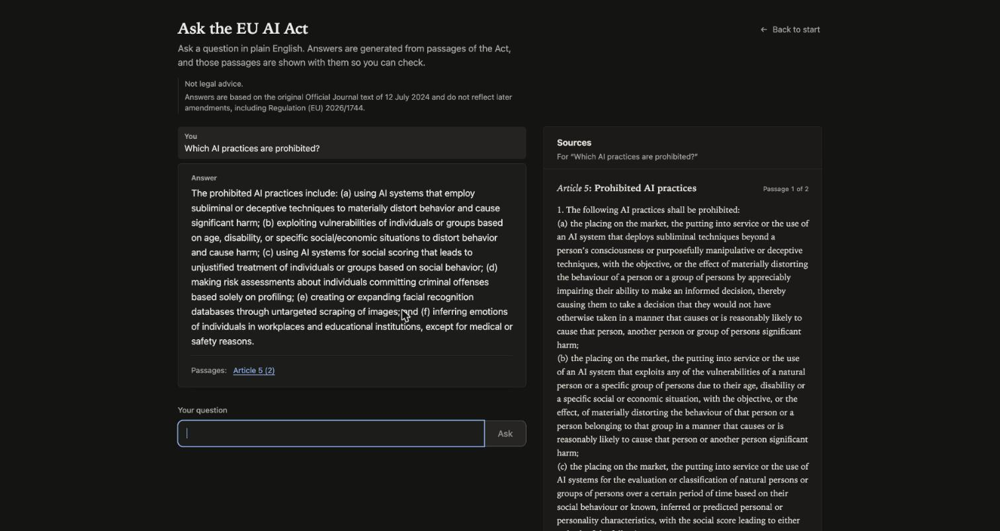
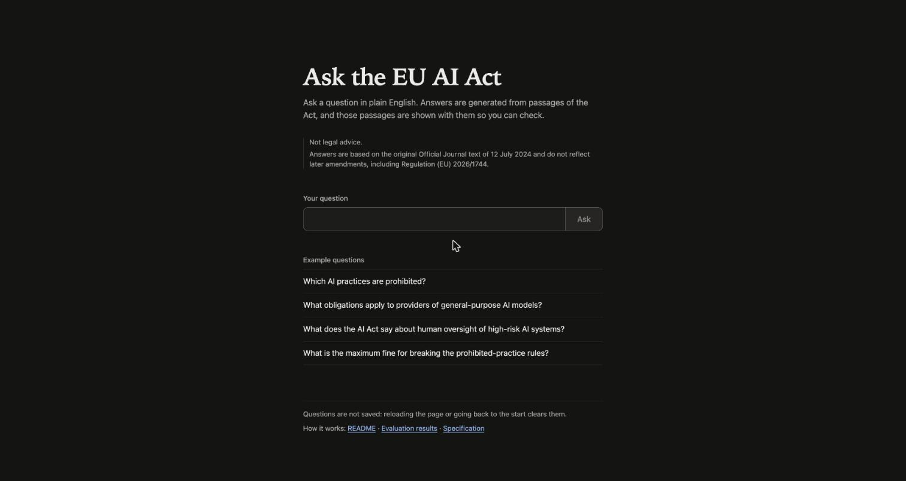
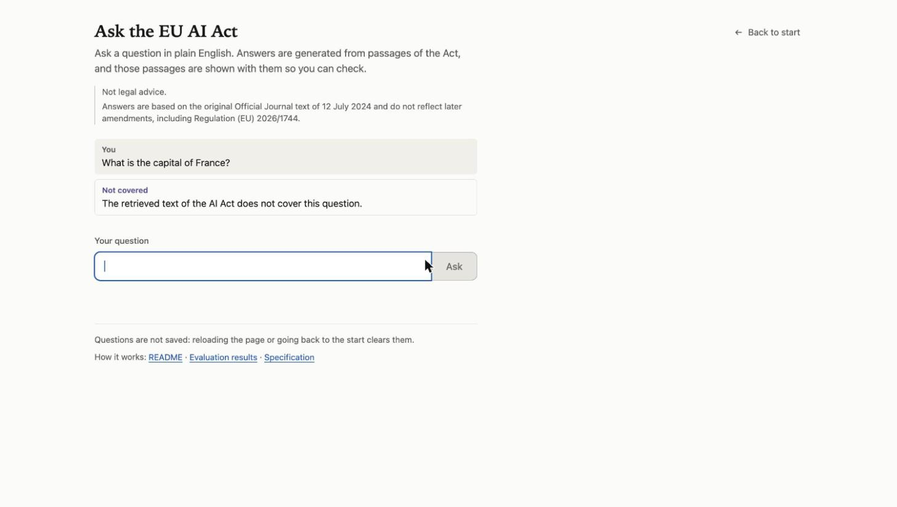
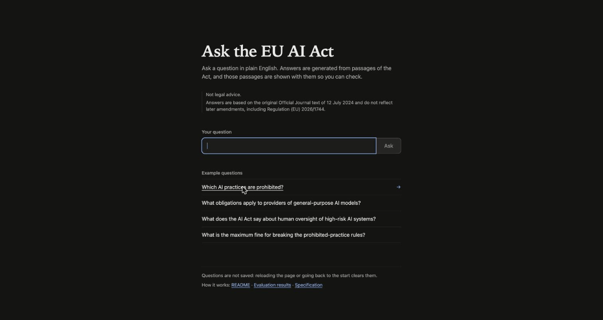
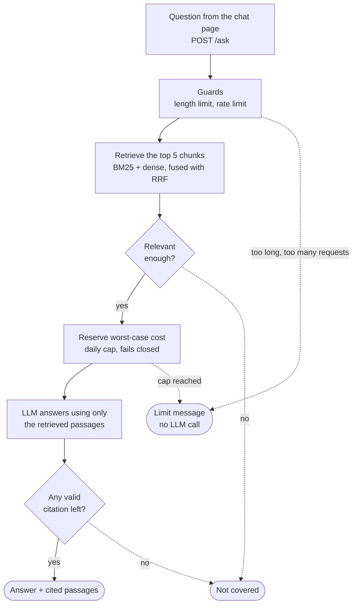

# Ask the EU AI Act

*A personal side project to experiment with retrieval-augmented generation (RAG).*

A small question-answering demo over the text of **Regulation (EU) 2024/1689 (the EU AI Act)** as published in the Official Journal on 12 July 2024. You ask a question in plain English; it retrieves the most relevant articles, recitals and annexes, asks an LLM to answer **only from those passages**, and shows the answer with the sections it cites. If the retrieved text does not cover the question, it says so instead of guessing.

> **Not legal advice.** Answers are based on the original Official Journal text and do not reflect later amendments.



| Start page | A question the Act does not cover |
|---|---|
|  |  |



*Screenshots and recording of a local run of the Docker setup below. The answer text is generated by the LLM and can change from run to run.*

The project was built spec-first: requirements, design and task list are in [`.kiro/specs/ask-the-eu-ai-act/`](.kiro/specs/ask-the-eu-ai-act/).

## How it works

**Answering a question.** The length limit, rate limit, relevance gate and spend cap all refuse before the LLM is called. Dotted lines are refusals.



**Building the index.** This happens once, when the image is built (or with `python -m askact.ingest`).


The evaluation harness (`python -m askact.evaluation.run`) calls the same retrieval and answer code, without the web server.

- The index is built **once, at image build time**, from the pinned source. The running app fetches nothing from EUR-Lex and downloads no models (`HF_HUB_OFFLINE=1`).
- The backend keeps no conversation memory. The "chat" is a list of independent question-and-answer turns in the browser, so every citation maps to exactly one retrieval.
- Citations the model invents (sections that were not retrieved) are dropped. An answer left with no valid citation is shown as "not covered".

## Quick start (Docker)

You need Docker with Compose and an OpenAI API key. Without a key the page loads, but no question can be answered.

1. Copy the settings file and fill in the LLM part:
   ```
   cp .env.example .env
   ```
   Set `LLM_PROVIDER=openai`, `LLM_MODEL`, `LLM_API_KEY`, and a price for that model in `LLM_PRICE_TABLE`, for example `{"your-model": {"input_per_mtok": 0.0, "output_per_mtok": 0.0}}` with the real prices in place of the zeros. No prices are shipped: a model without an entry is refused, because the spend cap fails closed.
2. Build and start (the first build takes several minutes: it downloads the Act's text, the two models and CPU-only PyTorch, and builds the search index):
   ```
   docker compose up --build
   ```
3. Open <http://localhost:3000> and ask a question, or call the backend directly:
   ```
   curl localhost:8000/health
   curl -s localhost:8000/ask -H 'content-type: application/json' \
     -d '{"question":"Which AI practices are prohibited?"}'
   ```

Stop with `docker compose down`. The daily spend total lives in the named volume `state`; `docker compose down -v` deletes it.

## Configuration

Every setting is an environment variable, documented in [`.env.example`](.env.example). The ones you are most likely to touch:

| Variable | Default | Meaning |
|---|---|---|
| `LLM_PROVIDER`, `LLM_MODEL`, `LLM_API_KEY` | unset | The LLM. `openai` is the only real provider. The key is a secret: keep it in `.env`, which is gitignored and never copied into an image. |
| `LLM_PRICE_TABLE` | unset | Per-model prices, as JSON. Required for paid use. |
| `DAILY_SPEND_CAP_USD` | `1.00` | Daily cap (UTC days). The worst-case cost of a call is reserved before it is made. |
| `MAX_QUESTION_CHARS` | `500` | Longer questions are refused before retrieval. |
| `RATE_LIMIT_PER_MINUTE` | `10` | Per client. |
| `RERANKER_ENABLED` | `false` | `true` serves `hybrid+rerank` instead of `hybrid`. |
| `CORS_ORIGINS` | `http://localhost:3000` | Origins allowed to call the backend. |
| `LOG_QUESTIONS` | `false` | By default no question text is logged anywhere. |

**Build-time settings.** `EMBEDDING_MODEL`, `RERANKER_MODEL`, `CHUNK_MAX_CHARS` and `NEXT_PUBLIC_API_URL` are used when the images are built, so changing one needs `docker compose up --build`. `NEXT_PUBLIC_API_URL` is written into the JavaScript the browser downloads, so it must be the backend's address **as the visitor's browser sees it**.

**Relevance thresholds** (`RELEVANCE_THRESHOLD_COSINE`, `RELEVANCE_THRESHOLD_RERANK`) were tuned on the dev split for the default models only. If you change a model, tune them again (`python -m askact.evaluation.run --no-generation` prints the score ranges).

## Reaching the backend

The browser calls the backend directly, so its port has to be reachable from the browser.

- **Local demo (what `docker-compose.yml` sets up).** The backend is published on `127.0.0.1:8000` and the page on `127.0.0.1:3000`. There is no proxy, so **leave `TRUSTED_PROXY_HEADER` unset**: if it is set, any client can send that header and choose its own rate-limit bucket.
- **Public deployment.** This needs exactly one proxy that you control, with the backend reachable only through it. Set `TRUSTED_PROXY_HEADER` (for example `X-Forwarded-For`): the client is then identified by the **last** entry of that header. Rebuild the UI with `NEXT_PUBLIC_API_URL` set to the backend's public URL, and add the UI's public origin to `CORS_ORIGINS`.

## Evaluation

The harness (`python -m askact.evaluation.run`, run from the repository root) runs the question set through four retrieval configurations and, for each, through the real answer pipeline with the real LLM:

- `bm25`: keyword search.
- `dense`: embedding similarity.
- `hybrid`: BM25 and dense, fused with reciprocal-rank fusion. This is what the app serves by default.
- `hybrid+rerank`: `hybrid`, with the top candidates re-scored by a cross-encoder.

**The question set.** `eval/questions.yaml` has 50 questions: **29 in `dev` (23 in-scope, 6 out-of-scope) and 21 in `test` (17 in-scope, 4 out-of-scope)**. **The questions were written by the project owner**, before any evaluation scores were seen. The split is a seeded shuffle within each category (`random.Random(2026)`, roughly 60% to `dev`). The relevance thresholds were tuned on `dev` only, and `test` was run once, as the final result.

### Results (test split, final)

Copied verbatim from [`eval/results.md`](eval/results.md), which also has the dev split, the score ranges and the metric definitions.

- Date: 2026-10-13 (UTC)
- k: 5 (chunks; hit@5 and MRR look at the top 5 chunks of each question)
- Embedding model: BAAI/bge-small-en-v1.5
- Reranker: cross-encoder/ms-marco-MiniLM-L-6-v2
- Index: 495 chunks
- Generation: LLM openai / gpt-4o-mini, at most 500 output tokens per answer
- Relevance thresholds (the gate): cosine 0.69, rerank 2.5

| Config | hit@5 | MRR | Refusal accuracy | Citation precision | Citation recall |
|---|---|---|---|---|---|
| bm25 | 0.824 (14/17) | 0.618 | 1.000 (4/4) | 0.382 | 0.529 |
| dense | 0.706 (12/17) | 0.593 | 1.000 (4/4) | 0.525 | 0.647 |
| hybrid | 0.824 (14/17) | 0.608 | 1.000 (4/4) | 0.539 | 0.735 |
| hybrid+rerank | 0.765 (13/17) | 0.632 | 1.000 (4/4) | 0.407 | 0.588 |

hit@5 and MRR are over the 17 in-scope questions. Refusal accuracy is over the 4 out-of-scope questions. Citation precision and recall are means over the 17 in-scope questions.

**How to read them**

- **The question sets are small, so differences between configurations may be within sampling noise.** On the test split, one in-scope question moves hit@5 by about six points. The ranking of the configurations differs between the dev and test splits, so this data neither supports "reranking helps" nor "reranking hurts", which is why the reranker is off by default.
- **Citation precision is a lower bound.** `expected_ids` lists operative provisions (articles and annexes) only, and the model often cites more sections than the list names. A relevant section that is not listed counts as wrong.
- **Refusal accuracy is measured on very few out-of-scope questions** and is weak evidence that refusal works in general.
- **The generation columns come from one run with one model.**

LLM replies are cached in `eval/.cache/` (gitignored), so re-running reproduces a result without new paid calls. To reproduce, install the `models` extra (`pip install -e "./backend[dev,models]"`), build the index with `python -m askact.ingest`, and pass `--split dev|test|both`, `--k` or `--configs`. `--no-generation` runs the retrieval metrics only, with no LLM and no key. **A run overwrites `eval/results.md`**, and a `test` run is the final result: do not tune on it.

## Size and memory

Measured on 2026-10-15 with Docker 29.8.2 on a MacBook Air (Apple Silicon), real embedder and reranker, CPU only, reranker off:

- **Backend image:** 2.25 GB disk usage (557 MB content size). It contains PyTorch (CPU), the two models and the search index.
- **Frontend image:** 437 MB disk usage (104 MB content size).
- **Backend idle memory:** 392 MiB, from one `docker stats --no-stream` taken shortly after the container reported healthy, without a fixed settling period and before it served a question. Memory grows once questions are answered, and more with the reranker on (not measured with Docker).

A separate run with Podman 5.2.3 on Linux x86_64 (2026-10-13) gave a 1.71 GB backend image and 467 MiB idle memory. The counters and tools differ between the two, so do not compare them.

## Limitations

- **One pinned document.** Only Regulation (EU) 2024/1689, as published in the Official Journal on 12 July 2024. It is the English HTML rendition from the Publications Office, which EUR-Lex describes as being for information, not the authentic signed PDF.
- **Later amendments are not reflected,** including Regulation (EU) 2026/1744 (the Digital Omnibus on AI). Check the current consolidated text before relying on any answer.
- **Retrieval limits.** Sections are split into chunks of at most 1,800 characters, tables are flattened to text, and the model only sees the top 5 chunks. Retrieval can miss the right section, as the hit@5 figures show.
- **The relevance gate can refuse an in-scope question, depending on the wording.** In one local run, "What is the maximum fine for breaking the prohibited-practice rules?" was answered "Not covered", while "What penalties apply when an operator breaks the AI Act?" was answered from Article 99. This was seen on a handful of questions, not measured.
- **Answers are generated, and not reviewed.** Grounding is enforced by the prompt and by citation checks, not guaranteed. No manual review of generated answers for faithfulness has been done, so none is reported.
- **The evaluation set is small.** See "How to read them".
- **Not legal advice.** This is a demo, not a substitute for a lawyer.
- **One worker, no accounts.** The rate limiter keeps its state in the process, so the backend runs a single uvicorn worker, and the spend ledger is a local SQLite file. The spend cap and rate limit are demo safeguards, not authentication.

## Development

```
# Backend tests: stubs and a fake LLM, no models, no network, no key
cd backend
pip install -e ".[dev]"
EMBEDDER=stub RERANKER=stub LLM_PROVIDER=fake pytest -m "not slow"

# Frontend tests and build
cd frontend
npm ci
npm test
npm run build
```

Tests marked `slow` need the real models or a key and run locally only (`pytest -m slow`). CI (`.github/workflows/ci.yml`) runs the two commands above, in a `backend` and a `frontend` job, with no secrets.

| Path | What is in it |
|---|---|
| `backend/askact/` | ingestion, index, retrieval, generation, guards, API, evaluation harness |
| `frontend/` | Next.js chat page |
| `eval/` | `questions.yaml` and `results.md` |
| `.kiro/specs/ask-the-eu-ai-act/` | requirements, design (including the trade-offs considered) and the task list |
