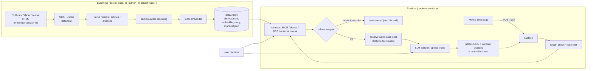

# Ask the EU AI Act

A small question-answering demo over the text of **Regulation (EU) 2024/1689 (the EU AI Act)** as published in the Official Journal on 12 July 2024. You ask a question in plain English; it retrieves the most relevant articles, recitals and annexes, asks an LLM to answer **only from those passages**, and shows the answer with the sections it cites. If the retrieved text does not cover the question, it says so instead of guessing.

> **Not legal advice.** Answers are based on the original Official Journal text and do not reflect later amendments, including Regulation (EU) 2026/1744.

The project was built spec-first: requirements, design and task list are in [`.kiro/specs/ask-the-eu-ai-act/`](.kiro/specs/ask-the-eu-ai-act/).

## How it works



- The index is built **once, at image build time**, from the pinned source. The running app fetches nothing from EUR-Lex and downloads no models (`HF_HUB_OFFLINE=1`).
- Retrieval and the relevance gate are free. Only the LLM call costs money, so everything that can refuse a request (length, rate limit, "not covered", spend cap) does so before the LLM is called.
- The backend keeps no conversation memory. The "chat" is a list of independent question-and-answer turns in the browser, so every citation maps to exactly one retrieval.
- Citations the model invents (sections that were not retrieved) are dropped. An answer left with no valid citation is shown as "not covered".
- The UI renders answers, sources and error messages as plain text, never as HTML or Markdown.

## Quick start (Docker)

You need Docker with Compose and an OpenAI API key. Without a key the page loads, but no question can be answered.

1. Copy the settings file and fill in the LLM part:
   ```
   cp .env.example .env
   ```
   Set `LLM_PROVIDER=openai`, `LLM_MODEL`, `LLM_API_KEY`, and a price for that model in `LLM_PRICE_TABLE`, for example `{"your-model": {"input_per_mtok": 0.0, "output_per_mtok": 0.0}}` with the real prices in place of the zeros. No prices are shipped: a model without an entry is refused, because the spend cap fails closed.
2. Build and start:
   ```
   docker compose up --build
   ```
   The first build takes several minutes (about 4.5 minutes on the machine used for the measurements below): it downloads the Act's text, the two models and CPU-only PyTorch, and builds the search index.
3. Open <http://localhost:3000> and ask a question, or call the backend directly:
   ```
   curl localhost:8000/health
   curl -s localhost:8000/ask -H 'content-type: application/json' \
     -d '{"question":"Which AI practices are prohibited?"}'
   ```

Stop with `docker compose down`. The daily spend total lives in the named volume `state`, so it survives re-creating the containers; `docker compose down -v` deletes the volume and with it today's total.

## Configuration

Every setting is an environment variable, documented in [`.env.example`](.env.example). `backend/askact/config.py` is the only place they are read, and a test keeps the two files in sync. The ones you are most likely to touch:

| Variable | Default | Meaning |
|---|---|---|
| `LLM_PROVIDER`, `LLM_MODEL`, `LLM_API_KEY` | unset | The LLM. `openai` is the only real provider. The key is a secret: keep it in `.env`, which is gitignored and never copied into an image. |
| `LLM_PRICE_TABLE` | unset | Per-model prices, as JSON. Required for paid use. |
| `DAILY_SPEND_CAP_USD` | `1.00` | Daily cap (UTC days). The worst-case cost of a call is reserved before it is made. |
| `MAX_OUTPUT_TOKENS` | `500` | Output-token limit per answer. |
| `MAX_QUESTION_CHARS` | `500` | Longer questions are refused before retrieval. |
| `RATE_LIMIT_PER_MINUTE` | `10` | Per client. |
| `RERANKER_ENABLED` | `false` | `true` serves `hybrid+rerank` instead of `hybrid`. |
| `CORS_ORIGINS` | `http://localhost:3000` | Origins allowed to call the backend. |
| `LOG_QUESTIONS` | `false` | Adds the question text to the request log line. By default no question text is logged anywhere. |

**Build-time settings.** `EMBEDDING_MODEL`, `RERANKER_MODEL`, `CHUNK_MAX_CHARS` and `NEXT_PUBLIC_API_URL` are used when the images are built. Changing one needs `docker compose up --build`. The backend refuses to search with an index built from other settings (`/health` is then 503) rather than answer from the wrong model. `NEXT_PUBLIC_API_URL` is written into the JavaScript that the browser downloads, so it must be the address of the backend **as the visitor's browser sees it**, and changing it when the container starts has no effect.

**The relevance thresholds** (`RELEVANCE_THRESHOLD_COSINE`, `RELEVANCE_THRESHOLD_RERANK`) were tuned on the dev split for the default models only. If you change `EMBEDDING_MODEL` or `RERANKER_MODEL`, they must be tuned again (`python -m askact.evaluation.run --no-generation` prints the score ranges).

## Reaching the backend

The browser calls the backend directly, so the backend port has to be reachable from the browser.

- **Local demo (what `docker-compose.yml` sets up).** The backend is published on `127.0.0.1:8000` and the page on `127.0.0.1:3000`, so only this machine can reach them. There is no proxy in front of the backend, so **leave `TRUSTED_PROXY_HEADER` unset**: if it is set, any client can send that header itself and choose its own rate-limit bucket.
- **Public deployment.** This needs exactly one proxy that you control, with the backend reachable only through it (do not publish its port). Set `TRUSTED_PROXY_HEADER` (for example `X-Forwarded-For`): the client is then identified by the **last** entry of that header, which the proxy appends. Rebuild the UI with `NEXT_PUBLIC_API_URL` set to the backend's public URL, and add the UI's public origin to `CORS_ORIGINS`.

## Evaluation

The harness (`python -m askact.evaluation.run`, run from the repository root) runs the question set through four retrieval configurations and, for each, through the real answer pipeline with the real LLM:

- `bm25`: keyword search.
- `dense`: embedding similarity.
- `hybrid`: BM25 and dense, fused with reciprocal-rank fusion. This is what the app serves by default.
- `hybrid+rerank`: `hybrid`, with the top candidates re-scored by a cross-encoder.

It reports hit@5 and MRR (does a chunk from an expected section appear in the top 5, and how high), refusal accuracy on questions the Act does not cover, and citation precision and recall. Definitions are in the tables below. LLM replies are cached in `eval/.cache/` (gitignored), so re-running reproduces a result without new paid calls, and `EVAL_MAX_LLM_CALLS` caps the number of uncached calls. `--no-generation` runs the retrieval metrics only, with no LLM and no key. To reproduce, install the `models` extra (`pip install -e "./backend[dev,models]"`), build the index with `python -m askact.ingest`, and pass `--split dev|test|both`, `--k` or `--configs` as needed. **A run overwrites `eval/results.md`**, and a `test` run is the final result: do not tune on it.

**The question set.** `eval/questions.yaml` has 50 questions: **29 in `dev` (23 in-scope, 6 out-of-scope) and 21 in `test` (17 in-scope, 4 out-of-scope)**. **The questions were written by the project owner**, before any evaluation scores were seen. The split between `dev` and `test` is a seeded shuffle within each category (`random.Random(2026)`, roughly 60% to `dev`), not a hand pick. The relevance thresholds were tuned on `dev` only, and `test` was run once, as the final result.

### Results

These are the tables written by the harness, copied verbatim from [`eval/results.md`](eval/results.md) (not typed). The `test` split is the final result.

- Date: 2026-10-13 (UTC)
- k: 5 (chunks; hit@5 and MRR look at the top 5 chunks of each question)
- Embedding model: BAAI/bge-small-en-v1.5
- Reranker: cross-encoder/ms-marco-MiniLM-L-6-v2
- Index: 495 chunks, build hash 6a5aac7af9cc03a7fc5d1755aa4955f68b24f1404c7eed8a9e6b88bf95c0022e
- Questions in dev: 23 in-scope, 6 out_of_scope
- Questions in test: 17 in-scope, 4 out_of_scope
- Generation: LLM openai / gpt-4o-mini, at most 500 output tokens per answer
- Relevance thresholds (the gate): cosine 0.69, rerank 2.5
- LLM calls: 59 made (limit 90), 83 answered from the cache. Each request is answered once and its reply is kept (`eval/.cache/`), so running again reproduces these numbers without new calls.

#### dev split

The split that parameters and thresholds are tuned on.

hit@5 and MRR are over the 23 in-scope questions only. MRR is the mean of 1 / (rank of the first chunk from an expected section), counting 0 when there is none in the top 5.

Refusal accuracy is over the 6 out_of_scope questions: the share the system answered "not covered" (the relevance gate refused, or the model said so, or none of its citations named a retrieved section). Citation precision and recall are means over the 23 in-scope questions of: cited sections that are expected / cited sections, and cited sections that are expected / expected sections. An answer with no citations, including a refusal, scores 0 on both.

| Config | hit@5 | MRR | Refusal accuracy | Citation precision | Citation recall |
|---|---|---|---|---|---|
| bm25 | 0.696 (16/23) | 0.415 | 1.000 (6/6) | 0.457 | 0.457 |
| dense | 0.826 (19/23) | 0.563 | 1.000 (6/6) | 0.587 | 0.638 |
| hybrid | 0.783 (18/23) | 0.594 | 1.000 (6/6) | 0.533 | 0.630 |
| hybrid+rerank | 0.913 (21/23) | 0.690 | 1.000 (6/6) | 0.481 | 0.587 |

Replies the model gave that could not be read (scored as no answer, not as a refusal): bm25 0, dense 0, hybrid 0, hybrid+rerank 0

Relevance score of the top-ranked chunk, lowest to highest (the gate's input; cosine and rerank scores are on different scales):

| Config | Scale | in-scope questions | out_of_scope questions |
|---|---|---|---|
| bm25 | cosine | 0.492 to 0.873 (n=23) | 0.464 to 0.653 (n=6) |
| dense | cosine | 0.611 to 0.880 (n=23) | 0.547 to 0.737 (n=6) |
| hybrid | cosine | 0.611 to 0.880 (n=23) | 0.508 to 0.737 (n=6) |
| hybrid+rerank | rerank | -11.107 to 8.975 (n=23) | -10.951 to 3.193 (n=6) |

#### test split: FINAL

The final result. It must not be used to choose parameters or thresholds (R5.10).

hit@5 and MRR are over the 17 in-scope questions only. MRR is the mean of 1 / (rank of the first chunk from an expected section), counting 0 when there is none in the top 5.

Refusal accuracy is over the 4 out_of_scope questions: the share the system answered "not covered" (the relevance gate refused, or the model said so, or none of its citations named a retrieved section). Citation precision and recall are means over the 17 in-scope questions of: cited sections that are expected / cited sections, and cited sections that are expected / expected sections. An answer with no citations, including a refusal, scores 0 on both.

| Config | hit@5 | MRR | Refusal accuracy | Citation precision | Citation recall |
|---|---|---|---|---|---|
| bm25 | 0.824 (14/17) | 0.618 | 1.000 (4/4) | 0.382 | 0.529 |
| dense | 0.706 (12/17) | 0.593 | 1.000 (4/4) | 0.525 | 0.647 |
| hybrid | 0.824 (14/17) | 0.608 | 1.000 (4/4) | 0.539 | 0.735 |
| hybrid+rerank | 0.765 (13/17) | 0.632 | 1.000 (4/4) | 0.407 | 0.588 |

Replies the model gave that could not be read (scored as no answer, not as a refusal): bm25 0, dense 0, hybrid 0, hybrid+rerank 0

Relevance score of the top-ranked chunk, lowest to highest (the gate's input; cosine and rerank scores are on different scales):

| Config | Scale | in-scope questions | out_of_scope questions |
|---|---|---|---|
| bm25 | cosine | 0.579 to 0.891 (n=17) | 0.294 to 0.685 (n=4) |
| dense | cosine | 0.648 to 0.891 (n=17) | 0.385 to 0.743 (n=4) |
| hybrid | cosine | 0.622 to 0.891 (n=17) | 0.341 to 0.743 (n=4) |
| hybrid+rerank | rerank | -4.176 to 9.921 (n=17) | -11.052 to 4.398 (n=4) |

### How to read them

- **The question sets are small, so differences between configurations may be within sampling noise.** On the test split, one in-scope question moves hit@5 by about six points. The ranking of the configurations differs between the dev and test splits, so it should not be read as "reranking helps" or "reranking hurts"; this data supports neither, which is why the reranker is off by default.
- **Citation precision is a lower bound.** `expected_ids` lists operative provisions (articles and annexes) only, and the model often cites more sections than the list names. A relevant section that is not listed counts as wrong, so low precision does not mean the answers are wrong. Retrieved recitals on the right topic also count as misses for hit@5 and MRR.
- **Refusal accuracy is measured on very few out-of-scope questions** and is weak evidence that refusal works in general.
- **The generation columns come from one run with one model** (see the metadata above). The retrieval columns were reproduced independently on a second machine.

## Size and memory

The backend image contains PyTorch (CPU), the two models and the search index, so it is large. These are measurements, not estimates; where something was not measured it says so.

| | Docker, 2026-10-15 | Podman, 2026-10-13 |
|---|---|---|
| Engine | Docker 29.8.2, Compose v5.5.0, on a MacBook Air (Apple Silicon); the Docker VM limit was 7.8 GiB | Podman 5.2.3 behind a `docker` command, Linux x86_64 |
| Backend image | **2.25 GB** disk usage (content size 557 MB), from `docker image ls` | **1.71 GB** (1,711,413,665 bytes), from `podman images` |
| Frontend image | 437 MB disk usage (content size 104 MB) | 299 MB |
| Backend idle memory, reranker off | **392 MiB**, from `docker stats --no-stream` (one reading) | **467 MiB** |
| Backend idle memory, reranker on | not measured | 479 MiB |
| Backend after five questions | not measured | 554 MiB (reranker off), 736 MiB (on; peak 815 MiB), one run each |

**Settings:** `EMBEDDER=real`, `RERANKER=real`, `BAAI/bge-small-en-v1.5`, `cross-encoder/ms-marco-MiniLM-L-6-v2`, `CHUNK_MAX_CHARS=1800`, 495 chunks, CPU only. The Docker run's log line shows `config: hybrid`, i.e. the reranker was off (`RERANKER_ENABLED=false`).

**Method, and why the two columns are not comparable.** The Docker memory figure is the container's `MEM USAGE` from a single `docker stats --no-stream` taken shortly after the container reported healthy, **without a fixed settling period**, and before it had served a question. The Podman figure is the resident set (`VmRSS`) of the app's main process read from `/proc/1/status`, after `/health` returned 200 and then 30 seconds with no requests; `podman stats` printed `0B` in that environment and was not used. They are different counters on different engines and CPU architectures, and the image sizes are reported by different tools, so do not subtract one from the other. Idle memory understates the cost of serving: memory grows once questions are answered, and more with the reranker on.

## Limitations

- **One pinned document.** Only Regulation (EU) 2024/1689, as published in the Official Journal on 12 July 2024. No other law, guidance, standard or case law.
- **English text only, and an information rendition.** The source is the English HTML rendition from the Publications Office. EUR-Lex describes the HTML as being for information; it is not the authentic signed PDF. The pinned source's SHA-256 is recorded in the index manifest.
- **Later amendments are not reflected.** The text is the original of 12 July 2024. Regulation (EU) 2026/1744 (the Digital Omnibus on AI) is one such amendment, and there may be others. Check the current consolidated text before relying on any answer.
- **Retrieval and parsing limits.** Sections are split into chunks of at most 1,800 characters, so one long article can be spread over several chunks. Tables are flattened to text lines. Retrieval can miss the right section, as the hit@5 figures above show, and the model only sees the top 5 chunks.
- **Answers are generated, and not reviewed.** Grounding is enforced by the prompt and by citation checks, not guaranteed. No manual review of generated answers for faithfulness has been done, so none is reported. Answers can still be wrong, incomplete, or cite a section that does not support the claim.
- **The evaluation set is small.** See "How to read them". The relevance thresholds were tuned on a small dev split, for the default models only.
- **Not legal advice.** This is a demo, not a substitute for a lawyer.
- **One worker.** The rate limiter keeps its state in the process, so the backend runs a single uvicorn worker, and the spend ledger is a local SQLite file that needs a local disk or Docker volume, not a network share.
- **Hosted-use limits.** The daily spend cap and rate limit are demo safeguards, not authentication. There are no user accounts.
- **Non-goals.** Authentication, user uploads, multiple documents, fine-tuning, and conversation memory.

## Development

```
# Backend tests: stubs and a fake LLM, no models, no network, no key
cd backend
pip install -e ".[dev]"
EMBEDDER=stub RERANKER=stub LLM_PROVIDER=fake pytest -m "not slow"

# Frontend tests and build
cd frontend
npm ci
npm test
npm run build
```

Tests marked `slow` need the real models or a key and run locally only (`pytest -m slow`). CI (`.github/workflows/ci.yml`) runs the two commands above, in a `backend` and a `frontend` job, with no secrets.

| Path | What is in it |
|---|---|
| `backend/askact/` | ingestion, index, retrieval, generation, guards, API, evaluation harness |
| `frontend/` | Next.js chat page |
| `eval/` | `questions.yaml` and `results.md` |
| `.kiro/specs/ask-the-eu-ai-act/` | requirements, design (including the trade-offs considered) and the task list |
